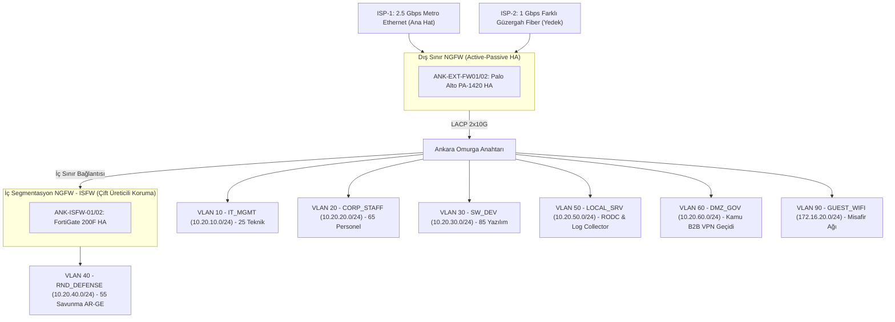

<!-- Path: 01-ankara-ofisi/README.md -->
# Ankara Ofisi — Kamu Projeleri, Gömülü Yazılım ve Savunma AR-GE Merkezi

Ankara yerleşkesi, **AegisNova Global**'in kamu kurumlarıyla yürüttüğü entegrasyon projelerini, gömülü sistem yazılım ekiplerini ve en yüksek gizlilik seviyesine sahip **Savunma & Kriptografi AR-GE** laboratuvarını barındırır. Bu nedenle şubede **Çift Katmanlı ve Çift Üreticili (Dual-Vendor Defense-in-Depth)** güvenlik duvarı mimarisi uygulanmıştır: Dış sınırda **Palo Alto PA-1420**, Savunma AR-GE iç sınırında ise **Fortinet FortiGate 200F (ISFW)** görev yapar.

- **Kural Seti ve CLI Konfigürasyonu:** [firewall-kurallari.md](firewall-kurallari.md)
- **Dış Sınır Cihaz Konfigürasyonu (PA-1420):** [configs/pa1420-perimeter.conf](configs/pa1420-perimeter.conf)
- **Savunma AR-GE İç Segmentasyon Konfigürasyonu (FG-200F ISFW):** [configs/fg200f-rnd-isfw.conf](configs/fg200f-rnd-isfw.conf)
- **Linux nftables + 3.5 Gbps tc QoS Betiği:** [configs/nftables-qos-ankara.sh](configs/nftables-qos-ankara.sh)

---

## 1. Kadro ve İnsan Kaynağı Dağılımı

| Kadro / Birim Kategorisi | Kişi Sayısı | Eşzamanlı Uç Nokta | Ağ Davranışı ve Güvenlik Profili |
|---|---:|---:|---|
| **İdari ve Kamu Proje Personeli** | **65** | ~80 cihaz | İhale, sözleşme, kamu proje koordinasyonu, kurumsal ERP/VoIP |
| **Öğrenci Sayısı** | **0** | 0 | Resmi öğrenci kadrosu Akademik Şube'de konumlandırılmıştır |
| **Akademisyen / Hoca Sayısı** | **0** | 0 | Akademik kadro Akademik Şube'de konumlandırılmıştır |
| **Yazılım Ekibi** | **85** | ~140 cihaz + test kartları | Gömülü yazılım, kamu B2B servis geliştirme, iç Git/CI-CD |
| **AR-GE Ekibi (Savunma & Kripto)** | **55** | ~95 izole iş istasyonu | FPGA/Donanım güvenliği ve kriptografi; **ISFW arkasında tam izole bölge** |
| **Teknik / IT Ekibi** | **17** | ~30 yönetim ucu | Yerel ağ/sistem yönetimi, saha operasyonları |
| **Güvenlik Ekibi** | **8** | ~15 analiz ucu | Kripto oda denetimi, yerel olay müdahalesi |
| **TOPLAM** | **230 Çalışan** | **~360 Kullanıcı Cihazı + ~35 Yerel Sunucu** | **Çift Katmanlı Savunma ve B2B Kamu Profili** |

---

## 2. Ankara Yerleşkesi Çift Katmanlı Güvenlik Duvarı Topolojisi

---

## 3. VLAN, Alt Ağ ve Bant Genişliği (QoS) Tahsis Planı

- **Toplam WAN Kapasitesi:** **2.5 Gbps Simetrik Ana Metro + 1.0 Gbps Farklı Güzergah Fiber = 3.5 Gbps**.
- **Hesaplanan Pik Yük:** **2.41 Gbps**.

| VLAN | Bölge (Zone) | Alt Ağ (CIDR) | Kapsanan Ekip / Sistem | Garanti Taban | Tavan (Max) | Öncelik (DSCP) |
|---:|---|---|---|---:|---:|---|
| 10 | `IT_MGMT` | `10.20.10.0/24` | 25 Teknik Personel & Log Aktarımı | 200 Mbps | 800 Mbps | `CS6` |
| 20 | `CORP_STAFF` | `10.20.20.0/24` | 65 İdari ve Proje Personeli | 250 Mbps | 900 Mbps | `AF21` |
| 30 | `SW_DEV` | `10.20.30.0/24` | 85 Gömülü ve Kamu Yazılım Ekibi | 800 Mbps | 2.000 Mbps | `AF31` |
| 40 | `RND_DEFENSE` | `10.20.40.0/24` | 55 Savunma AR-GE *(İnternete kapalı; yalnızca imzalı depo senkronu)* | 300 Mbps (İç/VPN) | 800 Mbps | `AF31` |
| 50 | `LOCAL_SRV` | `10.20.50.0/24` | Yerel RODC, Paket Aynası, 5651 Log | 300 Mbps | 1.000 Mbps | `AF41` |
| 60 | `DMZ_GOV` | `10.20.60.0/24` | Kamu Kurumları B2B IPsec Geçidi | 400 Mbps | 1.200 Mbps | `AF41` |
| 70 | `VOICE_IOT` | `10.20.70.0/24` | IP Telefon ve Kartlı/Biyometrik Geçiş | 100 Mbps | 300 Mbps | `EF` |
| 90 | `GUEST_WIFI` | `172.16.20.0/24` | Ziyaretçi Wi-Fi | Yok | 80 Mbps (Kişi başı 4 Mbps) | `CS1` |

---

---

En iyi 5 güvenlik duvarı adayları, bant genişliği tahmini ve seçim gerekçesi: [top5-firewall.md](top5-firewall.md). Şubeye özel kurulum ve testler: [kurulum-adimlari.md](kurulum-adimlari.md).
