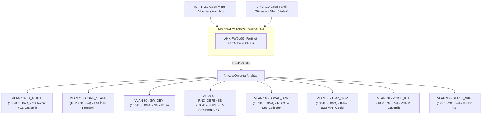

<!-- Path: 01-ankara-ofisi/README.md -->
# Ankara Ofisi — Kamu Projeleri, Gömülü Yazılım ve Savunma AR-GE Merkezi

Ankara yerleşkesi, **AegisNova Global**'in kamu kurumlarıyla yürüttüğü entegrasyon projelerini, yazılım ekiplerini ve en yüksek gizlilik seviyesine sahip **Savunma & Kriptografi AR-GE** birimini barındırır. Şubenin dış sınırında ve ağ omurgasında High Availability (Active-Passive) çalışan **Fortinet FortiGate 200F** güvenlik duvarı kümesi görev yapar.

- **Kural Seti ve CLI Konfigürasyonu:** [firewall-kurallari.md](firewall-kurallari.md)
- **Güvenlik Duvarı Konfigürasyonu (FortiGate 200F):** [configs/fg200f-rnd-isfw.conf](configs/fg200f-rnd-isfw.conf)
- **Linux nftables + 3 Gbps tc QoS Betiği:** [configs/nftables-qos-ankara.sh](configs/nftables-qos-ankara.sh)

---

## 1. Kadro ve İnsan Kaynağı Dağılımı (Resmi Matris)

| Kadro / Birim Kategorisi | Kişi Sayısı | Eşzamanlı Uç Nokta | Ağ Davranışı ve Güvenlik Profili |
|---|---:|---:|---|
| **İdari ve Kamu Proje Personeli (Admin staff)** | **140** | ~170 cihaz | İhale, sözleşme, kamu proje koordinasyonu, kurumsal ERP/VoIP |
| **Öğrenci Sayısı (Students)** | **0** | 0 | Öğrenci kadrosu Akademik Şube'dedir |
| **Akademisyen / Hoca Sayısı (Faculty)** | **0** | 0 | Akademik kadro Akademik Şube'dedir |
| **Yazılım Ekibi (Software)** | **30** | ~50 cihaz + test kartları | Gömülü yazılım, kamu B2B servis geliştirme, iç Git/CI-CD |
| **AR-GE Ekibi (Savunma & Kripto - R&D)** | **15** | ~25 izole iş istasyonu | Savunma kriptografi araştırmaları; internete kapalı izole bölge |
| **Teknik / IT Ekibi (Technical)** | **20** | ~35 yönetim ucu | Yerel ağ/sistem yönetimi, saha operasyonları |
| **Güvenlik Ekibi (Security)** | **15** | ~25 analiz ucu | Olay müdahale, SOC operasyonları ve B2B denetimi |
| **TOPLAM (Total)** | **220 Çalışan** | **~305 Cihaz + Sunucular** | **Kamu B2B ve Güvenli Kurumsal Profil** |

---

## 2. Ankara Yerleşkesi Güvenlik Duvarı Topolojisi

---

## 3. VLAN, Alt Ağ ve Bant Genişliği (QoS) Tahsis Planı

- **Gerekli Bant Genişliği (Formül):** **1.50 Gbps**.
- **Tahsis Edilen Hat:** **2.0 Gbps Ana Metro + 1.0 Gbps Yedek Fiber = 3.0 Gbps**.

| VLAN | Bölge (Zone) | Alt Ağ (CIDR) | Kapsanan Ekip / Sistem | Garanti Taban | Tavan (Max) | Öncelik (DSCP) |
|---:|---|---|---|---:|---:|---|
| 10 | `IT_MGMT` | `10.20.10.0/24` | 35 Teknik ve Güvenlik Personeli | 200 Mbps | 600 Mbps | `CS6` |
| 20 | `CORP_STAFF` | `10.20.20.0/24` | 140 İdari Personel | 350 Mbps | 1.000 Mbps | `AF21` |
| 30 | `SW_DEV` | `10.20.30.0/24` | 30 Yazılım Ekibi | 300 Mbps | 900 Mbps | `AF31` |
| 40 | `RND_DEFENSE` | `10.20.40.0/24` | 15 Savunma AR-GE *(İnternete kapalı)* | 150 Mbps (İç/VPN) | 500 Mbps | `AF31` |
| 50 | `LOCAL_SRV` | `10.20.50.0/24` | Yerel RODC, Paket Aynası, 5651 Log | 200 Mbps | 800 Mbps | `AF41` |
| 60 | `DMZ_GOV` | `10.20.60.0/24` | Kamu Kurumları B2B IPsec Geçidi | 250 Mbps | 800 Mbps | `AF41` |
| 70 | `VOICE_IOT` | `10.20.70.0/24` | IP Telefon ve Kartlı/Biyometrik Geçiş | 50 Mbps | 200 Mbps | `EF` |
| 90 | `GUEST_WIFI` | `172.16.20.0/24` | Ziyaretçi Wi-Fi | Yok | 50 Mbps (Kişi başı 4 Mbps) | `CS1` |

---

## 4. En İyi 5 Güvenlik Duvarı Tavsiyesi ve Seçim

| Sıra | Model | L4 Throughput | Threat Protection | SSL Inspection | Karar ve Gerekçe |
|---:|---|---:|---:|---:|---|
| **1** | **Fortinet FortiGate 200F (HA)** | **27 Gbps** | **3.0 Gbps** | **4.0 Gbps** | **SEÇİLDİ (Matris Kararı):** 1.50 Gbps pik gereksinimi ve 2+1 Gbps hattı %100 kapsar, F/P oranı ve yerleşik SOC entegrasyonu mükemmeldir. |
| **2** | Palo Alto PA-1420 | 9.8 Gbps | 4.8 Gbps | ~3.2 Gbps | Şube ölçeği için lisanslama maliyeti yüksek. |
| **3** | Check Point Quantum 6200 | 17 Gbps | 2.5 Gbps | 1.8 Gbps | SSL Inspection altında performans düşüşü. |
| **4** | Cisco Secure Firewall 1210 | 12 Gbps | 2.5 Gbps | 1.5 Gbps | Ayrı FMC yönetim sunucusu gerekir. |
| **5** | WatchGuard Firebox M390 | 18 Gbps | 1.8 Gbps | 1.2 Gbps | Kamu B2B tünellerinde kural derinliği sınırlı. |
