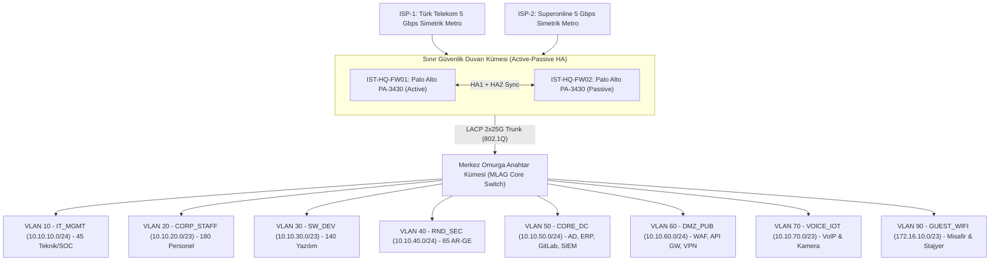

<!-- Path: 02-istanbul-ofisi/README.md -->
# İstanbul Ofisi — Genel Merkez (HQ), Ana Veri Merkezi ve Merkez SOC

İstanbul yerleşkesi, **AegisNova Global**'in yönetim üssü, birincil veri merkezi (Core Data Center), en büyük kurumsal yazılım geliştirme kampüsü, yapay zeka **AR-GE** laboratuvarı ve tüm şubeleri 7/24 denetleyen **Merkez SOC / NOC** birimidir.

- **Kural Seti ve CLI Konfigürasyonu:** [firewall-kurallari.md](firewall-kurallari.md)
- **Üretim Cihaz Konfigürasyonu (PAN-OS):** [configs/pa3430-running.conf](configs/pa3430-running.conf)
- **Linux nftables + 10 Gbps tc QoS Betiği:** [configs/nftables-qos-istanbul.sh](configs/nftables-qos-istanbul.sh)

---

## 1. Kadro ve İnsan Kaynağı Dağılımı

| Kadro / Birim Kategorisi | Kişi Sayısı | Eşzamanlı Uç Nokta | Ağ Davranışı ve Güvenlik Profili |
|---|---:|---:|---|
| **İdari ve Kurumsal Personel** | **180** | ~220 cihaz | Yönetim, Finans, İK, Hukuk, Satış; ERP/SaaS ve VoIP yoğunluklu |
| **Öğrenci Sayısı** | **0** | 0 *(Dönemsel 20 stajyer VLAN 90'da)* | Resmi öğrenci kadrosu Akademik Şube'de konumlandırılmıştır |
| **Akademisyen / Hoca Sayısı** | **0** | 0 | Akademik kadro Akademik Şube'de konumlandırılmıştır |
| **Yazılım Ekibi** | **140** | ~240 cihaz + test VM | Core Platform, FinTech, DevSecOps; yoğun GitLab, Docker/Harbor, Cloud API |
| **AR-GE Ekibi** | **65** | ~110 iş istasyonu/GPU | Yapay Zeka ve Siber Güvenlik AR-GE; yüksek izolasyon ve sıkı DLP denetimi |
| **Teknik / IT Ekibi** | **30** | ~60 yönetim ucu | Ağ/sistem mühendisleri, Panorama yöneticileri |
| **Güvenlik (SOC) Ekibi** | **15** | ~30 analiz ucu | 7/24 SOC Tier 1-2-3, tehdit avcılığı |
| **TOPLAM** | **430 Çalışan** | **~660 Kullanıcı Cihazı + ~120 DC Sunucu** | **Merkez Hub + Yüksek Güvenlikli Kurumsal Profil** |

---

## 2. İstanbul Yerleşkesi Ağ Topolojisi

---

## 3. VLAN, Alt Ağ ve Bant Genişliği (QoS) Tahsis Planı

- **Toplam WAN Kapasitesi:** **2 × 5 Gbps Simetrik Metro Ethernet = 10 Gbps** (SD-WAN Aktif/Aktif; tek ISP kesintisinde 5 Gbps kesintisiz).
- **Hesaplanan Pik Yük:** **4.85 Gbps** (%12 protokol ek yükü ve %30 büyüme payı dahil).

| VLAN | Bölge (Zone) | Alt Ağ (CIDR) | Kapsanan Ekip / Sistem | Garanti Taban | Tavan (Max) | Öncelik (DSCP) |
|---:|---|---|---|---:|---:|---|
| 10 | `IT_MGMT` | `10.10.10.0/24` | 45 Teknik & SOC, Panorama, SIEM | 500 Mbps | 2.000 Mbps | `CS6` (Yüksek) |
| 20 | `CORP_STAFF` | `10.10.20.0/23` | 180 İdari Personel | 600 Mbps | 2.500 Mbps | `AF21` |
| 30 | `SW_DEV` | `10.10.30.0/23` | 140 Yazılım Ekibi | 1.500 Mbps | 4.500 Mbps | `AF31` |
| 40 | `RND_SEC` | `10.10.40.0/24` | 65 AR-GE Ekibi | 1.000 Mbps | 3.000 Mbps | `AF31` |
| 50 | `CORE_DC` | `10.10.50.0/24` | İç Veri Merkezi & Şube Replikasyon | 1.500 Mbps | 5.000 Mbps | `AF41` |
| 60 | `DMZ_PUB` | `10.10.60.0/24` | Dışa Açık API, Kurumsal Web, VPN | 1.000 Mbps | 4.000 Mbps | `AF41` |
| 70 | `VOICE_IOT` | `10.10.70.0/23` | IP Telefonlar ve Fiziksel Güvenlik | 300 Mbps | 800 Mbps | `EF` (Gerçek Zamanlı) |
| 90 | `GUEST_WIFI` | `172.16.10.0/23` | Misafirler ve Dönemsel Stajyerler | Yok (Best Effort) | 250 Mbps (Kişi başı 5 Mbps) | `CS1` (Düşük) |

---

---

En iyi 5 güvenlik duvarı adayları, bant genişliği tahmini ve seçim gerekçesi: [top5-firewall.md](top5-firewall.md). Şubeye özel kurulum ve testler: [kurulum-adimlari.md](kurulum-adimlari.md).
