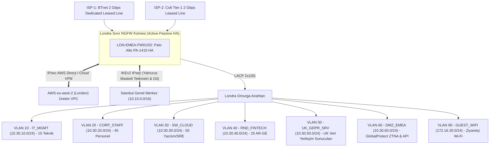

<!-- Path: 03-londra-ofisi/README.md -->
# Londra Ofisi — UK & EMEA Uluslararası Operasyon, Bulut Yazılım ve FinTech AR-GE

Londra yerleşkesi, **AegisNova Global**'in Birleşik Krallık ve Avrupa (EMEA) ticari merkezidir. Bulut-yerel (*Cloud-Native*) mikroservis yazılım ekibini, FinTech/RegTech **AR-GE** birimini ve uluslararası hukuk/satış kadrosunu barındırır. Şube mimarisi **UK-GDPR (Data Protection Act 2018)** ve **UK Cyber Essentials Plus** standartlarına tam uyumlu olarak kurgulanmıştır.

- **Kural Seti ve CLI Konfigürasyonu:** [firewall-kurallari.md](firewall-kurallari.md)
- **Üretim Cihaz Konfigürasyonu (PA-1410 UK-GDPR):** [configs/pa1410-ukgdpr.conf](configs/pa1410-ukgdpr.conf)
- **Linux nftables + 4.0 Gbps tc QoS Betiği:** [configs/nftables-qos-londra.sh](configs/nftables-qos-londra.sh)

---

## 1. Kadro ve İnsan Kaynağı Dağılımı

| Kadro / Birim Kategorisi | Kişi Sayısı | Eşzamanlı Uç Nokta | Ağ Davranışı ve Güvenlik Profili |
|---|---:|---:|---|
| **İdari, Uluslararası Satış ve Hukuk (DPO)** | **45** | ~60 cihaz | Sözleşme yönetimi, CRM, küresel video konferans, UK-GDPR kişisel veri işlemleri |
| **Öğrenci Sayısı** | **0** | 0 | Resmi öğrenci kadrosu Akademik Şube'de konumlandırılmıştır |
| **Akademisyen / Hoca Sayısı** | **0** | 0 | Akademik kadro Akademik Şube'de konumlandırılmıştır |
| **Yazılım Ekibi (Cloud-Native & SRE)** | **50** | ~95 cihaz + bulut tünelleri | AWS `eu-west-2 (London)` / Azure UK South entegrasyonu, Kubernetes, Terraform |
| **AR-GE Ekibi (FinTech & RegTech)** | **25** | ~45 iş istasyonu | Açık bankacılık API araştırmaları, finansal anomali modelleri, sıkı DLP koruması |
| **Teknik / IT Ekibi** | **10** | ~20 yönetim ucu | Yerel ağ operasyonları |
| **Güvenlik (CloudSec) Ekibi** | **5** | ~10 analiz ucu | Bulut güvenliği, İstanbul SOC ile entegre vardiya |
| **TOPLAM** | **135 Çalışan** | **~230 Kullanıcı Cihazı + ~25 Yerel/Edge Sunucu** | **Bulut Yoğunluklu ve UK-GDPR Veri Yerleşimi Odaklı Profil** |

---

## 2. Londra Yerleşkesi Ağ Topolojisi

---

## 3. VLAN, Alt Ağ ve Bant Genişliği (QoS) Tahsis Planı

- **Toplam WAN Kapasitesi:** **2 × 2 Gbps Simetrik Dedicated Leased Line = 4.0 Gbps** (Tam fiziksel güzergah yedekli).
- **Hesaplanan Pik Yük:** **1.67 Gbps**.

| VLAN | Bölge (Zone) | Alt Ağ (CIDR) | Kapsanan Ekip / Sistem | Garanti Taban | Tavan (Max) | Öncelik (DSCP) |
|---:|---|---|---|---:|---:|---|
| 10 | `IT_MGMT` | `10.30.10.0/24` | 15 Teknik & CloudSec Ekibi | 150 Mbps | 600 Mbps | `CS6` |
| 20 | `CORP_STAFF` | `10.30.20.0/24` | 45 İdari, Satış ve Hukuk Personeli | 250 Mbps | 800 Mbps | `AF21` |
| 30 | `SW_CLOUD` | `10.30.30.0/24` | 50 Cloud-Native Yazılım ve SRE Ekibi | 800 Mbps | 2.200 Mbps | `AF31` |
| 40 | `RND_FINTECH` | `10.30.40.0/24` | 25 FinTech AR-GE Ekibi | 400 Mbps | 1.200 Mbps | `AF31` |
| 50 | `UK_GDPR_SRV` | `10.30.50.0/24` | UK Yerel Müşteri/İK Veri Sunucuları | 300 Mbps | 1.000 Mbps | `AF41` |
| 60 | `DMZ_EMEA` | `10.30.60.0/24` | EMEA API Gateway ve Uzaktan Çalışma VPN | 300 Mbps | 1.200 Mbps | `AF41` |
| 70 | `VOICE_IOT` | `10.30.70.0/24` | Kurumsal VoIP ve Toplantı Odaları | 100 Mbps | 300 Mbps | `EF` |
| 90 | `GUEST_WIFI` | `172.16.30.0/24` | Ziyaretçi Wi-Fi | Yok | 60 Mbps (Kişi başı 5 Mbps) | `CS1` |

---

## 4. En İyi 5 Güvenlik Duvarı Tavsiyesi ve Seçim

| Sıra | Güvenlik Duvarı Modeli | L4 Stateful Throughput | Gerçek Threat Protection (IPS+AV+App) | Tahmini SSL/TLS Inspection | Eşzamanlı Oturum | Karar |
|---:|---|---:|---:|---:|---:|---|
| **1** | **Palo Alto Networks PA-1410** | 8.6 Gbps | **3.5 Gbps** | **~2.5 Gbps** | 980 Bin | **TERCİH EDİLEN ANA ÇÖZÜM** |
| **2** | Fortinet FortiGate 200F | 27.0 Gbps | 3.0 Gbps | 4.0 Gbps | 3.0 Milyon | Güçlü Alternatif |
| **3** | Juniper Networks SRX1600 | 25.0 Gbps | 4.6 Gbps | ~3.1 Gbps | 2.0 Milyon | Tercih Edilmedi |
| **4** | Cisco Secure Firewall 1220CX | 9.0 Gbps | 4.5 Gbps | ~2.2 Gbps | 600 Bin | Tercih Edilmedi |
| **5** | Check Point Quantum 6200 | 17.5 Gbps | 2.5 Gbps | ~1.8 Gbps | 2.0 Milyon | Tercih Edilmedi |

### Neden PA-1410 Seçildi ve Diğerleri Neden Tercih Edilmedi?
- **Seçim Gerekçesi:** 1.67 Gbps pik yüke karşılık 3.5 Gbps Threat Prevention kapasitesi sunar; yerleşik **Enterprise DLP** motoru ile UK-GDPR kapsamındaki müşteri verilerinin (IBAN, UK National Insurance Number, PII) sınır dışına çıkmasını engeller ve İstanbul Panorama ile tek merkezden yönetilir.
- **Diğerlerinin Elenme Nedeni:** FortiGate 200F ve Juniper SRX1600 kurumsal sınırda Panorama standartlaştırmasını bozacağı için, Cisco 1220CX ve Check Point 6200 ise daha düşük SSL Inspection ve DLP/SaaS görünürlüğü nedeniyle tercih edilmemiştir.
