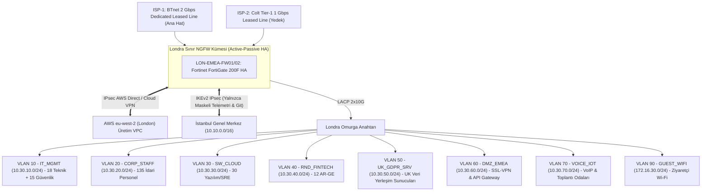

<!-- Path: 03-londra-ofisi/README.md -->
# Londra Ofisi — UK & EMEA Uluslararası Operasyon, Bulut Yazılım ve FinTech AR-GE

Londra yerleşkesi, **AegisNova Global**'in Birleşik Krallık ve Avrupa (EMEA) ticari merkezidir. Bulut-yerel (*Cloud-Native*) yazılım ekibini, FinTech/RegTech **AR-GE** birimini ve uluslararası hukuk/satış kadrosunu barındırır. Şube sınırında High Availability (Active-Passive) çalışan **Fortinet FortiGate 200F** güvenlik duvarı kümesi görev yapar ve **UK-GDPR (Data Protection Act 2018)** uyumlu DLP profilleriyle korunur.

- **Kural Seti ve CLI Konfigürasyonu:** [firewall-kurallari.md](firewall-kurallari.md)
- **Linux nftables + 3.0 Gbps tc QoS Betiği:** [configs/nftables-qos-londra.sh](configs/nftables-qos-londra.sh)

---

## 1. Kadro ve İnsan Kaynağı Dağılımı (Resmi Matris)

| Kadro / Birim Kategorisi | Kişi Sayısı | Eşzamanlı Uç Nokta | Ağ Davranışı ve Güvenlik Profili |
|---|---:|---:|---|
| **İdari, Uluslararası Satış ve Hukuk (Admin staff)** | **135** | ~170 cihaz | Sözleşme yönetimi, CRM, video konferans, UK-GDPR kişisel veri işlemleri |
| **Öğrenci Sayısı (Students)** | **0** | 0 | Öğrenci kadrosu Akademik Şube'dedir |
| **Akademisyen / Hoca Sayısı (Faculty)** | **0** | 0 | Akademik kadro Akademik Şube'dedir |
| **Yazılım Ekibi (Cloud & SRE - Software)** | **30** | ~60 cihaz + bulut tünelleri | AWS `eu-west-2 (London)` entegrasyonu, Kubernetes, Terraform |
| **AR-GE Ekibi (FinTech & RegTech - R&D)** | **12** | ~25 iş istasyonu | Açık bankacılık API araştırmaları, finansal anomali modelleri |
| **Teknik / IT Ekibi (Technical)** | **18** | ~30 yönetim ucu | Yerel ağ operasyonları, SaaS ve ofis altyapı yönetimi |
| **Güvenlik Ekibi (Security)** | **15** | ~25 analiz ucu | Bulut güvenliği, DLP denetimi, İstanbul SOC ile entegre nöbet |
| **TOPLAM (Total)** | **210 Çalışan** | **~310 Kullanıcı Cihazı + Sunucular** | **Bulut Yoğunluklu ve UK-GDPR Veri Yerleşimi Odaklı Profil** |

---

## 2. Londra Yerleşkesi Ağ Topolojisi

---

## 3. VLAN, Alt Ağ ve Bant Genişliği (QoS) Tahsis Planı

- **Gerekli Bant Genişliği (Formül):** **1.35 Gbps**.
- **Tahsis Edilen Hat:** **2.0 Gbps Ana Hat + 1.0 Gbps Yedek Hat = 3.0 Gbps**.

| VLAN | Bölge (Zone) | Alt Ağ (CIDR) | Kapsanan Ekip / Sistem | Garanti Taban | Tavan (Max) | Öncelik (DSCP) |
|---:|---|---|---|---:|---:|---|
| 10 | `IT_MGMT` | `10.30.10.0/24` | 33 Teknik & Güvenlik Ekibi | 150 Mbps | 600 Mbps | `CS6` |
| 20 | `CORP_STAFF` | `10.30.20.0/24` | 135 İdari, Satış ve Hukuk Personeli | 350 Mbps | 1.000 Mbps | `AF21` |
| 30 | `SW_CLOUD` | `10.30.30.0/24` | 30 Cloud-Native Yazılım ve SRE | 300 Mbps | 900 Mbps | `AF31` |
| 40 | `RND_FINTECH` | `10.30.40.0/24` | 12 FinTech AR-GE Ekibi | 150 Mbps | 600 Mbps | `AF31` |
| 50 | `UK_GDPR_SRV` | `10.30.50.0/24` | UK Yerel Müşteri/İK Veri Sunucuları | 200 Mbps | 800 Mbps | `AF41` |
| 60 | `DMZ_EMEA` | `10.30.60.0/24` | EMEA API Gateway ve Uzaktan Çalışma VPN | 200 Mbps | 800 Mbps | `AF41` |
| 70 | `VOICE_IOT` | `10.30.70.0/24` | Kurumsal VoIP ve Toplantı Odaları | 50 Mbps | 200 Mbps | `EF` |
| 90 | `GUEST_WIFI` | `172.16.30.0/24` | Ziyaretçi Wi-Fi | Yok | 50 Mbps (Kişi başı 5 Mbps) | `CS1` |

---

## 4. En İyi 5 Güvenlik Duvarı Tavsiyesi ve Seçim

| Sıra | Model | L4 Stateful Throughput | Threat Protection | SSL Inspection | Eşzamanlı Oturum | Karar ve Gerekçe |
|---:|---|---:|---:|---:|---:|---|
| **1** | **Fortinet FortiGate 200F (HA)** | **27.0 Gbps** | **3.0 Gbps** | **4.0 Gbps** | **3.0 Milyon** | **SEÇİLDİ (Matris Kararı):** 1.35 Gbps gereksinimi ve 2+1 Gbps hattı rahatça karşılar, UK-GDPR DLP yetenekleri ve FortiManager entegrasyonu tamdır. |
| **2** | Palo Alto PA-1410 | 8.6 Gbps | 3.5 Gbps | ~2.5 Gbps | 980 Bin | Lisanslama maliyeti yüksek. |
| **3** | Juniper SRX1500 | 20.0 Gbps | 2.5 Gbps | ~1.5 Gbps | 1.5 Milyon | DLP ve SaaS görünürlüğü zayıf. |
| **4** | Check Point Quantum 3800 | 9.0 Gbps | 1.5 Gbps | ~1.0 Gbps | 1.0 Milyon | SSL altında 1.35 Gbps'in altına düşer. |
| **5** | Cisco Secure Firewall 1210 | 12.0 Gbps | 2.5 Gbps | ~1.5 Gbps | 1.0 Milyon | Ek yönetim sunucusu gerekir. |
