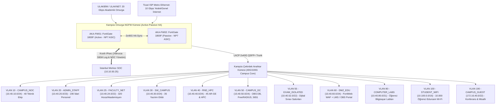

<!-- Path: 04-akademik-sube/README.md -->
# Akademik Şube — 10.000 Öğrencili AegisNova Teknoloji Kampüsü

Akademik Şube, **10.000 öğrenci**, **320 akademisyen (hoca)**, **190 idari personel**, **35 kişilik kampüs yazılım ekibi**, **45 kişilik akademik AR-GE / HPC ekibi** ve **40 kişilik kampüs teknik (NOC) ekibi** olmak üzere toplam **10.630 kişilik** dev bir üniversite/kampüs ekosistemidir.

Kurumsal ofislerden farklı olarak bu yerleşkenin en kritik mühendislik problemi; ders başlangıç dakikalarında 12.000'den fazla kablosuz cihazın aynı anda oluşturduğu **milyonlarca eşzamanlı TCP/UDP oturumu**, **CGNAT port yönetimi**, **Eduroam (802.1X) kimlik eşleştirmesi**, **Dijital Sınav Salonlarının kopya/dış erişim izolasyonu** ve **5651 sayılı kanun** kapsamında yasal log imzalamadır.

- **Kural Seti ve CLI Konfigürasyonu:** [firewall-kurallari.md](firewall-kurallari.md)
- **Kampüs Omurga Cihaz Konfigürasyonu (FortiGate 1800F):** [configs/fg1800f-campus.conf](configs/fg1800f-campus.conf)
- **Linux nftables + 30 Gbps tc QoS Kampüs Betiği:** [configs/nftables-qos-akademik.sh](configs/nftables-qos-akademik.sh)

---

## 1. Kadro ve Öğrenci Sayısı Dağılımı

| Kampüs Kullanıcı Kategorisi | Kişi Sayısı | Pik Eşzamanlı Cihaz | Ağ Davranışı ve Güvenlik İhtiyacı |
|---|---:|---:|---|
| **Öğrenci Sayısı** | **10.000** | **~11.700 cihaz** *(Pik %65 aktif × 1.8 cihaz)* | Eduroam Wi-Fi (`/16` havuz) ve Bilgisayar Labları; P2P/Torrent engelli, LMS/Video yoğunluklu, AP istemci izolasyonlu |
| **Akademisyen / Hoca Sayısı** | **320** | ~360 cihaz | Akademik yayın veri tabanları (IEEE/ScienceDirect/ULAKBİM), canlı ders, öğrenci ağından tam izole VLAN |
| **İdari Personel Sayısı** | **190** | ~210 cihaz | Öğrenci İşleri (OBS), Kütüphane, Mali İşler, Rektörlük/Dekanlık; yüksek veri gizliliği |
| **Yazılım Ekibi Sayısı** | **35** | ~55 cihaz + test sunucuları | OBS, LMS (Moodle/Canvas) ve Mobil Kampüs uygulaması geliştirme ekibi |
| **AR-GE Ekibi Sayısı (Akademik & HPC)** | **45** | ~75 iş istasyonu + HPC düğümleri | Yüksek Başarımlı Hesaplama (HPC) kümesi ve TÜBİTAK/Ufuk Avrupa araştırma projeleri |
| **Teknik / Kampüs NOC Ekibi** | **30** | ~50 yönetim ucu | 600+ Wi-Fi erişim noktası, FreeRADIUS yönetimi |
| **Güvenlik Ekibi** | **10** | ~20 analiz ucu | 5651 log, güvenlik duvarı yönetimi, kampüs olay müdahalesi |
| **TOPLAM KAMPÜS NÜFUSU** | **10.630 Kişi** | **~12.470 Eşzamanlı İstemci + ~90 Sunucu** | **Yüksek Yoğunluklu Kampüs, CGNAT ve 802.1X Profili** |

---

## 2. Akademik Şube Kampüs Ağ Topolojisi

---

## 3. VLAN, Alt Ağ ve 30 Gbps Bant Genişliği (QoS) Tahsis Planı

- **Toplam WAN Kapasitesi:** **20 Gbps ULAKNET Simetrik + 10 Gbps Ticari ISP Metro Ethernet = 30.0 Gbps**.
- **Hesaplanan Pik Yük:** **24.46 Gbps** (10.000 öğrenci pik saat + kadro + dış LMS erişimi + %25 büyüme payı).
- **SD-WAN Yönlendirme Mantığı:** Akademik veri tabanları (IEEE, Springer, Scopus), Eduroam üst federasyon ve TÜBİTAK/ULAKBİM trafiği doğrudan **20 Gbps ULAKNET** hattına; genel sosyal medya/video ve ticari CDN trafiği ise QoS ile şekillendirilerek **10 Gbps Ticari ISP + ULAKNET taşma (overflow)** politikasına yönlendirilir.

| VLAN | Bölge (Zone) | Alt Ağ (CIDR) | Kapsanan Grup | Garanti Taban | Tavan (Max) | Kişi Başı Sınır (Per-IP Shaper) |
|---:|---|---|---|---:|---:|---|
| 10 | `CAMPUS_NOC` | `10.40.10.0/24` | 40 Kampüs Teknik / NOC | 500 Mbps | 2.000 Mbps | Sınırsız |
| 20 | `ADMIN_STAFF` | `10.40.20.0/23` | 190 İdari Personel | 600 Mbps | 2.000 Mbps | 50 Mbps |
| 25 | `FACULTY_NET` | `10.40.24.0/22` | **320 Akademisyen / Hoca** | 2.000 Mbps | 5.000 Mbps | 100 Mbps |
| 30 | `SW_CAMPUS` | `10.40.30.0/24` | 35 Kampüs Yazılım Ekibi | 500 Mbps | 2.000 Mbps | 100 Mbps |
| 40 | `RND_HPC` | `10.40.40.0/24` | 45 Akademik AR-GE & HPC | 2.000 Mbps | 8.000 Mbps | Sınırsız (ULAKNET Öncelikli) |
| 50 | `CAMPUS_DC` | `10.40.50.0/24` | İç Veritabanı, RADIUS, 5651 | 1.000 Mbps | 4.000 Mbps | Sunucu Politikası |
| 55 | `EXAM_ISOLATED`| `10.40.52.0/22` | Dijital Sınav Salonları | **0 Mbps WAN** *(İnternet Kapalı)* | Yalnızca İç LMS Sınav IP | Dış Çıkış Yasak |
| 60 | `DMZ_EDU` | `10.40.60.0/24` | LMS, OBS ve Kampüs Web | 3.000 Mbps | 10.000 Mbps | WAF DDoS Korumalı |
| 80 | `COMPUTER_LABS`| `10.40.80.0/21` | Sabit Öğrenci Labları | 1.500 Mbps | 4.000 Mbps | 30 Mbps DL / 15 Mbps UL |
| 100 | `STUDENT_WIFI` | `10.100.0.0/16` | **10.000 Öğrenci Wi-Fi** *(65.534 IP)* | 10.000 Mbps | 18.000 Mbps | **15 Mbps DL / 8 Mbps UL (Max 400 Oturum)** |
| 190 | `CAMPUS_GUEST` | `172.16.40.0/22` | Sempozyum & Misafir Ağı | Yok | 500 Mbps | **5 Mbps DL / 2 Mbps UL** |

---

---

En iyi 5 güvenlik duvarı adayları, bant genişliği tahmini ve seçim gerekçesi: [top5-firewall.md](top5-firewall.md). Şubeye özel kurulum ve testler: [kurulum-adimlari.md](kurulum-adimlari.md).
