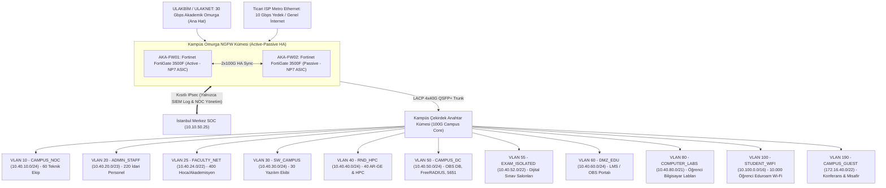

<!-- Path: 04-akademik-sube/README.md -->
# Akademik Şube — 10.000 Öğrencili Kalkan Teknoloji Kampüsü

Akademik Şube, **10.000 öğrenci**, **400 akademisyen (hoca)**, **220 idari personel**, **30 kişilik kampüs yazılım ekibi**, **40 kişilik akademik AR-GE ekibi** ve **60 kişilik kampüs teknik (NOC) ekibi** olmak üzere toplam **10.750 kişilik** dev bir üniversite/kampüs ekosistemidir.

Yerleşkenin omurgasında High Availability (Active-Passive) çalışan **Fortinet FortiGate 3500F** güvenlik duvarı kümesi görev yapar. Donanımsal **NP7** işlemcileriyle 10.000 öğrencinin oluşturduğu milyonlarca eşzamanlı oturumu, **CGNAT** işlemlerini, **Eduroam (802.1X)** kimlik doğrulamasını, **Dijital Sınav Salonlarının** dış erişim izolasyonunu ve **5651 sayılı kanun** log imzalamasını kesintisiz yürütür.

- **Kural Seti ve CLI Konfigürasyonu:** [firewall-kurallari.md](firewall-kurallari.md)
- **Linux nftables + 40 Gbps tc QoS Kampüs Betiği:** [configs/nftables-qos-akademik.sh](configs/nftables-qos-akademik.sh)

---

## 1. Kadro ve Öğrenci Sayısı Dağılımı (Resmi Matris)

| Kampüs Kullanıcı Kategorisi | Kişi Sayısı | Pik Eşzamanlı Cihaz | Ağ Davranışı ve Güvenlik İhtiyacı |
|---|---:|---:|---|
| **Öğrenci Sayısı (Students)** | **10.000** | **~11.700 cihaz** *(Pik %65 aktif × 1.8 cihaz)* | Eduroam Wi-Fi (`/16` havuz) ve Bilgisayar Labları; P2P engelli, LMS/Video yoğunluklu, AP izolasyonlu |
| **Akademisyen / Hoca Sayısı (Faculty)** | **400** | ~450 cihaz | Akademik veri tabanları (IEEE/ScienceDirect), canlı ders, öğrenci ağından tam izole VLAN |
| **İdari Personel Sayısı (Admin staff)** | **220** | ~260 cihaz | Öğrenci İşleri (OBS), Kütüphane, Mali İşler, Rektörlük; yüksek veri gizliliği |
| **Yazılım Ekibi Sayısı (Software)** | **30** | ~50 cihaz + test sunucuları | OBS, LMS (Moodle/Canvas) ve Mobil Kampüs yazılım geliştirme ekibi |
| **AR-GE Ekibi Sayısı (R&D)** | **40** | ~70 iş istasyonu + HPC | Yüksek Başarımlı Hesaplama (HPC) ve ulusal/uluslararası araştırma projeleri |
| **Teknik / Kampüs NOC Ekibi (Technical)** | **60** | ~90 yönetim ucu | Kampüs ağ altyapısı, 600+ AP ve sistem yönetimi |
| **Güvenlik Ekibi (Security)** | **0** | - | Güvenlik operasyonları merkez SOC ve kampüs NOC koordinasyonunda yürütülür |
| **TOPLAM KAMPÜS NÜFUSU (Total)** | **10.750 Kişi** | **~12.620 Eşzamanlı İstemci + Sunucular** | **Yüksek Yoğunluklu Kampüs, CGNAT ve 802.1X Profili** |

---

## 2. Akademik Şube Kampüs Ağ Topolojisi

---

## 3. VLAN, Alt Ağ ve 40 Gbps Bant Genişliği (QoS) Tahsis Planı

- **Gerekli Bant Genişliği (Formül):** **27.29 Gbps**.
- **Tahsis Edilen Hat:** **30 Gbps ULAKNET Ana Hat + 10 Gbps Ticari ISP Yedek Hat = 40.0 Gbps**.

| VLAN | Bölge (Zone) | Alt Ağ (CIDR) | Kapsanan Grup | Garanti Taban | Tavan (Max) | Kişi Başı Sınır (Per-IP Shaper) |
|---:|---|---|---|---:|---:|---|
| 10 | `CAMPUS_NOC` | `10.40.10.0/24` | 60 Kampüs Teknik / NOC | 800 Mbps | 2.500 Mbps | Sınırsız |
| 20 | `ADMIN_STAFF` | `10.40.20.0/23` | 220 İdari Personel | 800 Mbps | 2.500 Mbps | 50 Mbps |
| 25 | `FACULTY_NET` | `10.40.24.0/22` | **400 Akademisyen / Hoca** | 2.500 Mbps | 6.000 Mbps | 100 Mbps |
| 30 | `SW_CAMPUS` | `10.40.30.0/24` | 30 Kampüs Yazılım Ekibi | 500 Mbps | 2.000 Mbps | 100 Mbps |
| 40 | `RND_HPC` | `10.40.40.0/24` | 40 Akademik AR-GE & HPC | 2.500 Mbps | 10.000 Mbps | Sınırsız (ULAKNET Öncelikli) |
| 50 | `CAMPUS_DC` | `10.40.50.0/24` | İç Veritabanı, RADIUS, 5651 | 1.500 Mbps | 5.000 Mbps | Sunucu Politikası |
| 55 | `EXAM_ISOLATED`| `10.40.52.0/22` | Dijital Sınav Salonları | **0 Mbps WAN** *(İnternet Kapalı)* | Yalnızca İç LMS Sınav IP | Dış Çıkış Yasak |
| 60 | `DMZ_EDU` | `10.40.60.0/24` | LMS, OBS ve Kampüs Web | 3.500 Mbps | 12.000 Mbps | WAF DDoS Korumalı |
| 80 | `COMPUTER_LABS`| `10.40.80.0/21` | Sabit Öğrenci Labları | 2.000 Mbps | 5.000 Mbps | 30 Mbps DL / 15 Mbps UL |
| 100 | `STUDENT_WIFI` | `10.100.0.0/16` | **10.000 Öğrenci Wi-Fi** *(65.534 IP)* | 12.000 Mbps | 20.000 Mbps | **15 Mbps DL / 8 Mbps UL (Max 400 Oturum)** |
| 190 | `CAMPUS_GUEST` | `172.16.40.0/22` | Sempozyum & Misafir Ağı | Yok | 600 Mbps | **5 Mbps DL / 2 Mbps UL** |

---

## 4. En İyi 5 Güvenlik Duvarı Tavsiyesi ve Seçim

| Sıra | Güvenlik Duvarı Modeli | L4 Stateful Throughput | Gerçek Threat Protection | Tahmini SSL Inspection | Eşzamanlı Oturum | Karar |
|---:|---|---:|---:|---:|---:|---|
| **1** | **Fortinet FortiGate 3500F (HA)** | **163.0 Gbps** | **63.0 Gbps** | **35.0 Gbps** | **120 Milyon** | **SEÇİLDİ (Matris Kararı):** 27.29 Gbps formül ihtiyacını ve 30+10 Gbps hattı donanımsal NP7 ile tam yükte karşılar; 120 milyon oturum kapasitesi 10.000 öğrenci için rakipsizdir. |
| **2** | Palo Alto Networks PA-5430 | 80.0 Gbps | 41.0 Gbps | ~25.0 Gbps | 10.0 Milyon | Lisans maliyeti kampüs bütçesi için çok yüksek. |
| **3** | Check Point Quantum 16200 | 55.0 Gbps | 24.0 Gbps | ~16.0 Gbps | 10.0 Milyon | 27.29 Gbps pik gereksinim altında kalır. |
| **4** | Juniper Networks SRX4600 | 75.0 Gbps | 22.0 Gbps | ~14.5 Gbps | 20.0 Milyon | Threat Protection yetersiz. |
| **5** | Cisco Secure Firewall 4125 | 75.0 Gbps | 32.0 Gbps | ~18.0 Gbps | 25.0 Milyon | CGNAT karmaşıklığı. |
