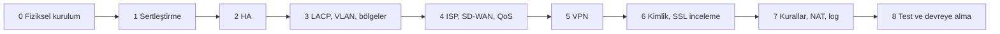

# Her Şubede Ortak Kurulum Adımları

Bu adımlar dört şubede aynı sırayla uygulanır. Şubeye özel ayarlar ve kabul testleri her şubenin `kurulum-adimlari.md` dosyasındadır: [Ankara](01-ankara-ofisi/kurulum-adimlari.md), [İstanbul](02-istanbul-ofisi/kurulum-adimlari.md), [Londra](03-londra-ofisi/kurulum-adimlari.md), [Akademik](04-akademik-sube/kurulum-adimlari.md), [Yazılım ekibi](05-yazilim-ekibi/kurulum-adimlari.md), [AR-GE ekibi](06-arge-ekibi/kurulum-adimlari.md).

## Faz 0 – Fiziksel kurulum

1. Birincil ve ikincil cihazı farklı kabinete (veya farklı U'ya) tak.
2. Her cihazın iki güç kaynağını iki ayrı UPS hattındaki PDU-A ve PDU-B'ye bağla.
3. Konsol portlarını LTE yedekli out-of-band konsol sunucusuna bağla; WAN kopsa da merkez erişebilsin.
4. Port standardı: `MGMT` yalnızca yönetim VLAN'ı, `HA1` kontrol, `HA2` oturum senkronu, `WAN-1` ve `WAN-2` iki farklı ISP, `LAN` iç omurgaya LACP.

## Faz 1 – Sertleştirme

1. Üreticinin önerdiği kararlı (LTS) firmware'i yükle, sürümün özetini doğrula.
2. Varsayılan yönetici parolasını değiştir; en az 16 karakter ve karmaşıklık zorunlu.
3. Yönetim arayüzünü yalnızca yönetim VLAN'ına ve SOC alt ağına aç; HTTP, Telnet, SNMPv1/v2c kapat.
4. MFA aç; NTP (iç sunucu) ve syslog (TLS) ayarla; oturum zaman aşımı 10 dakika.

## Faz 2 – High Availability

1. Active-Passive HA; preemption **kapalı** (dalgalanmayı önler).
2. Bağlantı ve yol izleme açık: LACP veya ISP portu koparsa yedek cihaz 1 saniyeden kısa sürede devralır.
3. Oturum senkronu açık (stateful failover); ayrı kontrol (HA1) ve veri (HA2) bağlantısı.

## Faz 3 – Arayüz, VLAN ve bölgeler

1. İç omurgaya 802.3ad LACP ile bağlan.
2. Her VLAN'ı ayrı 802.1Q alt arayüzü ve ayrı güvenlik bölgesi yap (VLAN planı: ana [README](README.md#2-ağ-topolojisi-ve-vlan--ip-planı)).
3. Kullanıcı kimliğini (AD veya 802.1X RSSO) bölgelere bağla.

## Faz 4 – ISP, SD-WAN ve QoS

1. İki ISP üzerinden sağlık kontrolü: eşikler gecikme < 45 ms (Londra < 65 ms), titreşim < 10 ms, kayıp < %0,5.
2. Eşik aşılırsa VoIP, canlı ders ve VPN oturum kopmadan diğer hatta geçer.
3. README'deki 8 sınıflı QoS profilini çıkış arayüzlerine bağla; kişi başı limitleri ekle.

## Faz 5 – Şubeler arası VPN

1. IKEv2, AES-256-GCM, SHA-384, DH grup 20; IKE ömrü 8 saat, IPsec ömrü 1 saat, PFS açık.
2. Sanal tünel arayüzleri üzerinde BGP ile dinamik yönlendirme.
3. Akademik şubeden yalnızca NOC ve SIEM alt ağlarını tünele ekle; öğrenci ağını ekleme.

## Faz 6 – Kimlik ve SSL inceleme

1. Ofislerde AD/LDAPS ile IP–kullanıcı eşleşmesi; akademik şubede FreeRADIUS accounting ile RSSO.
2. İç kök sertifikayı GPO/MDM ile dağıt; personel, yazılım ve AR-GE giden HTTPS'i çöz.
3. Finans, sağlık ve kamu kategorilerini şifre çözmeden muaf tut (KVKK, UK-GDPR). Öğrenci ağında sertifika zorlama yok; SNI + DNS filtre + uygulama kontrolü kullan.

## Faz 7 – Kurallar, NAT ve loglama

1. Şubenin `firewall-kurallari.md` dosyasındaki kuralları merkezi yönetimden (Panorama / FortiManager) önizleme ile bas; en alta `deny all + log`.
2. Kaynak NAT ve DMZ hedef NAT; akademik şubede port bloğu tahsisli CGNAT.
3. Logları SIEM'e syslog TLS 6514 ile gönder. Türkiye şubelerinde 5651 için saatlik özet alınıp zaman damgasıyla (TÜBİTAK) imzalanır ve 2 yıl saklanır; Londra'da kimlikler maskelenir.

## Faz 8 – Test ve devreye alma

Pazar 02:00–06:00 bakım penceresinde şu altı test yapılır:

1. HA: birincil cihazın gücünü kes, ikincilin 1 saniyeden kısa sürede devraldığını ve oturumların düşmediğini doğrula.
2. ISP kesintisi: ISP-1'i çıkar, trafiğin ISP-2'ye kayıpsız geçtiğini doğrula.
3. Segmentasyon: öğrenci ve misafir VLAN'ından iç ağlara `nmap`; hepsi reddedilmeli, 5 saniyede SIEM alarmı oluşmalı.
4. Zararlı yazılım: EICAR dosyasını HTTPS ile indir; engellenmeli.
5. QoS: öğrenci VLAN'ında hız testi; 15 Mbps'de sınırlanmalı.
6. Yedek: konfigürasyon yedeğinin şifreli olarak merkezi depoya alındığını doğrula.

Haftalık konfigürasyon yedeği alınır; her kural değişikliği talep numarası ve ikinci kişinin onayıyla yapılır (4 göz ilkesi).
