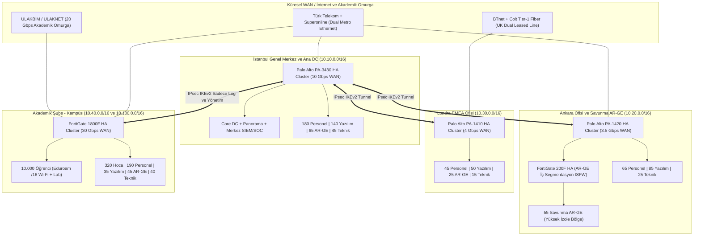

<!-- Path: README.md -->
# AegisNova Global — Kurumsal Ağ Güvenliği, Bant Genişliği ve Çok Şubeli NGFW Mimarisi


-2EA44F?style=flat-square)


Bu depo, çok uluslu teknoloji üretimi, ileri seviye **AR-GE**, büyük ölçekli **Yazılım Geliştirme** ve **10.000 öğrencili Akademik Kampüs** operasyonlarını tek çatı altında yürüten kurgusal **AegisNova Global Teknoloji ve Eğitim A.Ş.** şirketinin uçtan uca güvenlik duvarı (Next-Generation Firewall - NGFW) mimarisini, matematiksel bant genişliği planlamasını, adım adım kurulum prosedürlerini, şube bazlı kural setlerini ve 7/24 SOC izleme (monitoring) yapısını içermektedir.

## Canlı Test ve Laboratuvar Simülasyon Kaydı



---

## İçindekiler

1. [Kurumsal Senaryo ve Organizasyonel Ölçek](#1-kurumsal-senaryo-ve-organizasyonel-ölçek)
2. [Küresel Ağ Topolojisi ve IPAM Özeti](#2-küresel-ağ-topolojisi-ve-ipam-özeti)
3. [Şube Bazlı Kadro, Bant Genişliği ve Güvenlik Duvarı Matrisi](#3-şube-bazlı-kadro-bant-genişliği-ve-güvenlik-duvarı-matrisi)
4. [Depo Klasör Yapısı ve Dokümantasyon Haritası](#4-depo-klasör-yapısı-ve-dokümantasyon-haritası)
5. [Kod Tabanı, Simülasyon Motoru ve İzleme Altyapısını Çalıştırma](#5-kod-tabanı-simülasyon-motoru-ve-izleme-altyapısını-çalıştırma)
6. [Temel Mühendislik Prensipleri](#6-temel-mühendislik-prensipleri)

---

## 1. Kurumsal Senaryo ve Organizasyonel Ölçek

**AegisNova Global**, iki farklı ülkede konumlanmış üç kurumsal ofis ve bir büyük akademik yerleşkeden oluşan hibrit bir teknoloji ve eğitim grubudur:

- **İstanbul Ofisi (Genel Merkez, Ana Veri Merkezi ve Merkez SOC):** Kurumsal yönetim, finans, insan kaynakları, ana yazılım platform ekipleri, yapay zeka AR-GE laboratuvarı ve tüm şubelerin loglarını toplayan 7/24 Güvenlik Operasyon Merkezi (SOC) burada yer alır.
- **Ankara Ofisi (Kamu Projeleri ve Savunma AR-GE Merkezi):** Kamu kurumlarıyla B2B entegrasyon yürüten yazılım ekipleri ile yüksek izolasyon (Internal Segmentation Firewall - ISFW) gerektiren kriptografi ve savunma AR-GE birimini barındırır.
- **Londra Ofisi (UK ve EMEA Operasyon Merkezi):** Avrupa satış/hukuk operasyonları, bulut-yerel (Cloud-Native) yazılım/SRE ekibi ve FinTech AR-GE grubunu içerir. **UK-GDPR** veri yerleşimi kurallarına tabidir.
- **Akademik Şube (AegisNova Teknoloji Kampüsü):** **10.000 öğrenci**, **320 akademisyen (hoca)**, **190 idari personel**, kampüs yazılım ekibi, akademik AR-GE/HPC laboratuvarı ve kampüs NOC/teknik ekibinden oluşan yüksek yoğunluklu eğitim yerleşkesidir. **ULAKNET**, **Eduroam (802.1X)** ve **5651 sayılı kanun** gereksinimlerine tam uyumludur.

---

## 2. Küresel Ağ Topolojisi ve IPAM Özeti

Şubeler arası iletişim, yedekli servis sağlayıcılar (Dual-ISP) üzerinde koşan **SD-WAN** ve **IKEv2 IPsec (AES-256-GCM)** tünelleriyle Hub-and-Spoke + Kısmi Mesh topolojisinde kurgulanmıştır.



---

## 3. Şube Bazlı Kadro, Bant Genişliği ve Güvenlik Duvarı Matrisi

Aşağıdaki ana tablo, şirketin tüm yerleşkelerindeki insan kaynağı dağılımını, hesaplanan ve tahsis edilen hat kapasitelerini ve seçilen birincil güvenlik duvarı donanımlarını özetlemektedir:

| Şube / Yerleşke | İdari Personel | Akademisyen (Hoca) | Öğrenci | Yazılım Ekibi | AR-GE Ekibi | Teknik / IT Ekibi | Toplam Kişi | Tahsis Edilen WAN Bant Genişliği | Seçilen Birincil NGFW (Aktif-Pasif HA) |
|---|---:|---:|---:|---:|---:|---:|---:|---|---|
| **[İstanbul Ofisi](subeler/istanbul-ofisi/README.md)** | 180 | 0 | 0 | 140 | 65 | 45 | **430** | 2 × 5 Gbps Simetrik Metro (**10 Gbps**) | **Palo Alto Networks PA-3430** |
| **[Ankara Ofisi](subeler/ankara-ofisi/README.md)** | 65 | 0 | 0 | 85 | 55 | 25 | **230** | 2.5 Gbps Ana + 1 Gbps Yedek (**3.5 Gbps**) | **Palo Alto PA-1420** (Dış) + **FortiGate 200F** (İç AR-GE) |
| **[Londra Ofisi](subeler/londra-ofisi/README.md)** | 45 | 0 | 0 | 50 | 25 | 15 | **135** | 2 × 2 Gbps Leased Line (**4 Gbps**) | **Palo Alto Networks PA-1410** |
| **[Akademik Şube](subeler/akademik-sube/README.md)** | 190 | 320 | 10.000 | 35 | 45 | 40 | **10.630** | 20 Gbps ULAKNET + 10 Gbps ISP (**30 Gbps**) | **Fortinet FortiGate 1800F** |
| **GENEL TOPLAM** | **480** | **320** | **10.000** | **310** | **190** | **125** | **11.425** | **47.5 Gbps Toplam Kapasite** | **Çok Katmanlı Hibrit NGFW Mimarisi** |

> [!IMPORTANT]
> Güvenlik duvarı kapasite seçimlerinde üreticilerin "L4 Stateful Firewall" verileri değil; **IPS + Application Control + Anti-Malware + SSL/TLS Inspection** açıkken elde edilen gerçek dünya **Threat Protection Throughput** değerleri esas alınmış ve en az **%35 büyüme payı (headroom)** bırakılmıştır.

---

## 4. Depo Klasör Yapısı ve Dokümantasyon Haritası

Proje, hem şube bazlı derinlemesine incelemeye hem de konu bazlı mühendislik okumasına olanak tanıyacak şekilde modüler olarak yapılandırılmıştır:

```text
firewallödev/
├── README.md                                              # Kurumsal mimari özet, canlı test kaydı ve ana indeks
├── assets/
│   └── ngfw-live-test-demo.svg                            # GitHub README içinde otomatik oynayan canlı test kaydı
├── go.mod                                                 # Go 1.24+ sıfır bağımlılıklı modül tanımı
├── start-lab.ps1                                          # Tek komutla Canlı Web NGFW & SOC Laboratuvarı başlatıcı
├── cmd/
│   ├── aegisnova-sim/
│   │   └── main.go                                        # Kapasite, NGFW paket simülasyonu, SOAR ve Prometheus CLI
│   └── aegisnova-lab/
│       ├── main.go                                        # Tarayıcı tabanlı interaktif NGFW, QoS, HA ve SOC Web Lab
│       ├── ui.html                                        # Gömülü modern koyu tema canlı SOC kontrol merkezi arayüzü
│       └── main_test.go                                   # Web Lab REST API, SOAR ve HA Failover testleri
├── lab/                                                   # Çoklu Alt Ağ Gerçek Linux nftables + tc QoS Docker Lab
│   ├── README.md                                          # Mod-1 (Web Lab) ve Mod-2 (Docker Lab) kullanım rehberi
│   ├── Dockerfile.ngfw                                    # Alpine tabanlı nftables, tc HTB, curl, tcpdump düğüm imajı
│   ├── docker-compose.lab.yml                             # 14 konteyner ve 10 alt ağlı gerçek yönlendirme topolojisi
│   └── scripts/
│       ├── init-fw-node.sh                                # Şube bazlı çekirdek kurallarını yükleyen başlatıcı
│       └── run-lab-tests.sh                               # 10 adımlı otomatik uçtan uca paket doğrulama betiği
├── internal/
│   ├── capacity/
│   │   └── calculator.go                                  # Matematiksel bant genişliği ve Top 5 NGFW seçim motoru
│   ├── firewall/
│   │   ├── engine.go                                      # Bölge, User-ID/802.1X, App-ID ve Per-IP QoS kural motoru
│   │   └── engine_test.go                                 # Otomatik birim testleri ve paket işleme hızı ölçümü
│   └── soc/
│       └── monitor.go                                     # SIEM korelasyonu, 5651 SHA-256 zinciri, UK-GDPR ve SOAR
├── izleme-stack/                                          # 7/24 SOC & NOC İzleme Altyapısı (Infrastructure-as-Code)
│   ├── docker-compose.yml                                 # Prometheus + Grafana + Alertmanager + Loki yığını
│   ├── prometheus/
│   │   ├── prometheus.yml                                 # 4 şube NGFW ve 5651 telemetri toplama hedefleri
│   │   └── alert_rules.yml                                # PromQL CPU, HA, Conntrack ve Yanal Tarama alarmları
│   └── grafana/
│       └── ngfw-soc-dashboard.json                        # İçe aktarılabilir 4 şube canlı SOC/NOC Grafana panosu
├── subeler/                                               # Şube bazlı kadro, ağ, Top 5 FW, kural setleri ve konfigler
│   ├── istanbul-ofisi/
│   │   ├── README.md                                      # İstanbul kadrosu, VLAN/IPAM, 10 Gbps QoS ve Top 5 FW
│   │   ├── firewall-kurallari.md                          # İstanbul HQ, Yazılım, AR-GE ve DC kural seti
│   │   └── configs/
│   │       ├── pa3430-running.conf                        # Tam Palo Alto PAN-OS HA, IPsec, QoS ve kural konfigi
│   │       └── nftables-qos-istanbul.sh                   # Linux nftables + tc HTB 10 Gbps laboratuvar betiği
│   ├── ankara-ofisi/
│   │   ├── README.md                                      # Ankara kadrosu, VLAN/IPAM, 3.5 Gbps QoS ve Top 5 FW
│   │   ├── firewall-kurallari.md                          # Ankara Kamu B2B ve Savunma AR-GE ISFW kural seti
│   │   └── configs/
│   │       ├── pa1420-perimeter.conf                      # Ankara dış sınır PAN-OS konfigürasyonu
│   │       ├── fg200f-rnd-isfw.conf                       # Ankara Savunma AR-GE FortiGate 200F ISFW konfigi
│   │       └── nftables-qos-ankara.sh                     # Linux nftables + tc HTB 3.5 Gbps laboratuvar betiği
│   ├── londra-ofisi/
│   │   ├── README.md                                      # Londra kadrosu, UK-GDPR ağ yapısı, 4 Gbps QoS ve Top 5 FW
│   │   ├── firewall-kurallari.md                          # Londra Cloud/EMEA ve veri yerleşimi kural seti
│   │   └── configs/
│   │       ├── pa1410-ukgdpr.conf                         # Londra PAN-OS UK-GDPR kilitli tam konfigürasyon
│   │       └── nftables-qos-londra.sh                     # Linux nftables + tc HTB 4.0 Gbps laboratuvar betiği
│   └── akademik-sube/
│       ├── README.md                                      # 10.000 Öğrenci + 630 kadro, 30 Gbps QoS ve Top 5 FW
│       ├── firewall-kurallari.md                          # Öğrenci, Hoca, Sınav Ağı, Eduroam ve 5651 kural seti
│       └── configs/
│           ├── fg1800f-campus.conf                        # FortiGate 1800F PBA-CGNAT, RSSO, Sınav ve QoS konfigi
│           └── nftables-qos-akademik.sh                   # Linux nftables + tc HTB 30 Gbps kampüs betiği
└── dokumanlar/                                            # Merkez mühendislik ve operasyon dokümanları
    ├── 01-bant-genisligi-ve-kapasite-planlama.md          # Matematiksel bant genişliği formülleri ve QoS tasarımı
    ├── 02-top5-guvenlik-duvari-ve-tercih-analizi.md       # Şube ve birim bazlı Top 5 NGFW + Neden diğerleri seçilmedi?
    ├── 03-adim-adim-guvenlik-duvari-kurulumu.md           # Faz 0 - Faz 8 uçtan uca tüm şubelere kurulum rehberi
    └── 04-izleme-monitoring-ve-soc-mimarisi.md            # Sistematik (SIEM/Grafana/NetFlow) ve İnsani (SOC/CAB) izleme
```

### Hızlı Erişim Bağlantıları

- **Kapasite ve QoS Mühendisliği:** [01-bant-genisligi-ve-kapasite-planlama.md](dokumanlar/01-bant-genisligi-ve-kapasite-planlama.md)
- **Top 5 Güvenlik Duvarı Tavsiyeleri ve Tercih Edilmeyenlerin Analizi:** [02-top5-guvenlik-duvari-ve-tercih-analizi.md](dokumanlar/02-top5-guvenlik-duvari-ve-tercih-analizi.md)
- **Adım Adım Güvenlik Duvarı Kurulum Rehberi:** [03-adim-adim-guvenlik-duvari-kurulumu.md](dokumanlar/03-adim-adim-guvenlik-duvari-kurulumu.md)
- **Profesyonel İzleme (Monitoring) — Sistematik ve İnsani Boyut:** [04-izleme-monitoring-ve-soc-mimarisi.md](dokumanlar/04-izleme-monitoring-ve-soc-mimarisi.md)

---

## 5. Kod Tabanı, Simülasyon Motoru ve İzleme Altyapısını Çalıştırma

Depo içerisinde dokümanlardaki tüm matematiksel formülleri, 4 şubenin Sıfır Güven güvenlik duvarı kurallarını, **5651 SHA-256 zaman damgası zincirini**, **UK-GDPR kimlik maskelemeyi** ve **SOAR otomatik karantinayı** birebir çalıştıran **Go (`go1.24+`)** tabanlı doğrulama motoru yer almaktadır (~**3.62 Milyon paket/saniye** tek çekirdek değerlendirme performansı).

### 5.1. Canlı İnteraktif Web NGFW & SOC Laboratuvarını Başlatma (`localhost:8080`)

Hiçbir ek kurulum gerektirmeden tarayıcınızda 4 şubenin canlı yükünü izlemek, özel paket enjekte etmek, **HA Failover / ISP Kesintisi**, **Sınav Salonu Kilidi**, **Savunma AR-GE İzolasyonu** ve **SOAR Otomatik Karantina** tatbikatlarını çalıştırmak için:

```powershell
# PowerShell ile tek komutta başlatma ve tarayıcıda açma
.\start-lab.ps1

# Veya doğrudan Go ile başlatma
go run ./cmd/aegisnova-lab -addr 127.0.0.1:8080
```

> Detaylı Docker çoklu alt ağ (`nftables` + `tc HTB QoS`) laboratuvar kurulumu için: [lab/README.md](lab/README.md)

### 5.2. Terminal Simülasyon ve Birim Testlerini Çalıştırma

```powershell
# Tüm şubelerin bant genişliği hesabını, 12 güvenlik senaryosunu ve SOC/SOAR korelasyonunu çalıştırır
go run ./cmd/aegisnova-sim

# Çıktıyı otomasyon / API entegrasyonu için JSON formatında üretir
go run ./cmd/aegisnova-sim --json

# Kural motoru ve Canlı Web Laboratuvarı birim testlerini çalıştırır
go test -v ./internal/... ./cmd/...
```

### 5.3. Canlı Prometheus ve Grafana SOC Panosunu Başlatma

```powershell
# 1. NGFW canlı telemetri sunucusunu (:9115/metrics) başlatın
go run ./cmd/aegisnova-sim --serve-metrics :9115

# 2. Ayrı bir terminalde Prometheus, Grafana, Alertmanager ve Loki yığınını ayağa kaldırın
cd izleme-stack
docker compose up -d
```

---

## 6. Temel Mühendislik Prensipleri

1. **Sıfır Güven (Zero Trust Segmentation):** Aynı fiziksel binada bulunsalar dahi İdari Personel, Yazılım Ekibi, AR-GE Ekibi, Akademisyenler ve Öğrenciler ayrı VLAN ve Güvenlik Bölgelerinde (`Security Zone`) tutulur; bölgeler arası trafik güvenlik duvarı üzerinde kullanıcı kimliği (`User-ID` / `802.1X`) ve uygulama katmanı (`App-ID`) bazında denetlenir.
2. **Tek Hata Noktasının Ortadan Kaldırılması (No Single Point of Failure):** Tüm şubelerde çift servis sağlayıcı (Dual-ISP), çift güç kaynağı (Dual-PSU) ve **Active-Passive High Availability (HA)** küme yapısı zorunludur.
3. **Savunmada Derinlik (Defense-in-Depth):** Kurumsal sınırda (Perimeter) Palo Alto kullanılırken, Ankara Savunma AR-GE iç segmentasyonunda (ISFW) Fortinet tercih edilerek tek üretici zafiyetlerine karşı çift üreticili izolasyon sağlanmıştır. Akademik Şube'de ise 10.000 öğrencinin oluşturduğu milyonlarca eşzamanlı NAT oturumunu donanımsal ASIC (NP7) ile karşılamak üzere FortiGate 1800F konumlandırılmıştır.
4. **Kayıtlı Açık Reddetme (Explicit Deny & Log):** Hiçbir güvenlik duvarında sessiz varsayılan düşürme (`Implicit Drop without Log`) bırakılmaz; kural tabanının en altında tüm yetkisiz erişim denemelerini SIEM'e ileten açık bir `DENY-ALL-AND-LOG` kuralı yer alır.
5. **Yasal ve Regülatif Tam Uyum:** Türkiye yerleşkelerinde **5651 Sayılı Kanun** (TÜBİTAK Zaman Damgalı loglama) ve **KVKK**, Londra yerleşkesinde ise **UK-GDPR** veri minimizasyonu ve sınır ötesi aktarım kısıtları doğrudan kural setlerine ve izleme mimarisine işlenmiştir.

