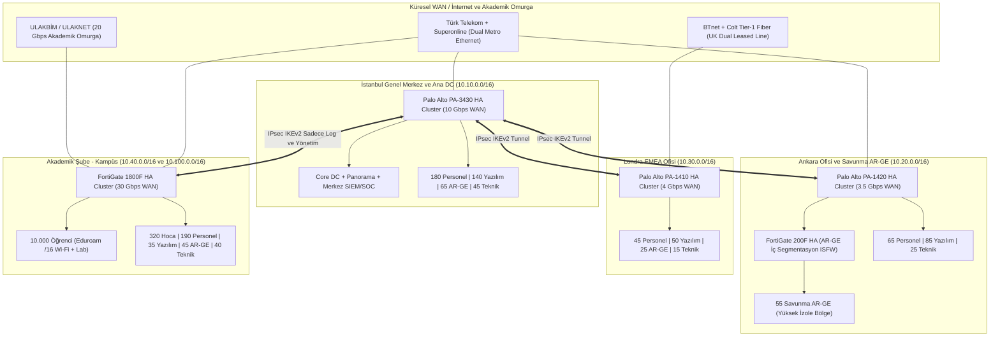

<!-- Path: README.md -->
# AegisNova Global — Kurumsal Ağ Güvenliği, Bant Genişliği ve Çok Şubeli NGFW Mimarisi


-2EA44F?style=flat-square)


Bu depo, çok uluslu teknoloji üretimi, ileri seviye **AR-GE**, büyük ölçekli **Yazılım Geliştirme** ve **10.000 öğrencili Akademik Kampüs** operasyonlarını tek çatı altında yürüten kurgusal **AegisNova Global Teknoloji ve Eğitim A.Ş.** şirketinin uçtan uca güvenlik duvarı (Next-Generation Firewall - NGFW) mimarisini, matematiksel bant genişliği planlamasını, şube bazlı VLAN bölünmesini, en uygun güvenlik duvarı seçimlerini, şube bazlı kural setlerini ve 7/24 SOC izleme (monitoring) yapısını içermektedir.

---

## İçindekiler

1. [Kurumsal Senaryo ve Organizasyonel Ölçek](#1-kurumsal-senaryo-ve-organizasyonel-ölçek)
2. [Küresel Ağ Topolojisi ve IPAM Özeti](#2-küresel-ağ-topolojisi-ve-ipam-özeti)
3. [Şube Bazlı Kadro, Bant Genişliği ve Güvenlik Duvarı Matrisi](#3-şube-bazlı-kadro-bant-genişliği-ve-güvenlik-duvarı-matrisi)
4. [Depo Yapısı](#4-depo-yapısı)
5. [Temel Mühendislik Prensipleri](#5-temel-mühendislik-prensipleri)

---

## 1. Kurumsal Senaryo ve Organizasyonel Ölçek

**AegisNova Global**, iki farklı ülkede konumlanmış üç kurumsal ofis ve bir büyük akademik yerleşkeden oluşan hibrit bir teknoloji ve eğitim grubudur:

- **İstanbul Ofisi (Genel Merkez, Ana Veri Merkezi ve Merkez SOC):** Kurumsal yönetim, finans, insan kaynakları, ana yazılım platform ekipleri, yapay zeka AR-GE laboratuvarı ve tüm şubelerin loglarını toplayan 7/24 Güvenlik Operasyon Merkezi (SOC) burada yer alır.
- **Ankara Ofisi (Kamu Projeleri ve Savunma AR-GE Merkezi):** Kamu kurumlarıyla B2B entegrasyon yürüten yazılım ekipleri ile yüksek izolasyon (Internal Segmentation Firewall - ISFW) gerektiren kriptografi ve savunma AR-GE birimini barındırır.
- **Londra Ofisi (UK ve EMEA Operasyon Merkezi):** Avrupa satış/hukuk operasyonları, bulut-yerel (Cloud-Native) yazılım/SRE ekibi ve FinTech AR-GE grubunu içerir. **UK-GDPR** veri yerleşimi kurallarına tabidir.
- **Akademik Şube (AegisNova Teknoloji Kampüsü):** **10.000 öğrenci**, **320 akademisyen (hoca)**, **190 idari personel**, kampüs yazılım ekibi, akademik AR-GE/HPC laboratuvarı ve kampüs NOC/teknik ekibinden oluşan yüksek yoğunluklu eğitim yerleşkesidir. **ULAKNET**, **Eduroam (802.1X)** ve **5651 sayılı kanun** gereksinimlerine tam uyumludur.

---

## 2. Küresel Ağ Topolojisi ve IPAM Özeti

Şubeler arası iletişim, yedekli servis sağlayıcılar (Dual-ISP) üzerinde koşan **SD-WAN** ve **IKEv2 IPsec (AES-256-GCM)** tünelleriyle Hub-and-Spoke + Kısmi Mesh topolojisinde kurgulanmıştır.



---

## 3. Şube Bazlı Kadro, Bant Genişliği ve Güvenlik Duvarı Matrisi

Aşağıdaki ana tablo, şirketin tüm yerleşkelerindeki insan kaynağı dağılımını, hesaplanan ve tahsis edilen hat kapasitelerini ve seçilen birincil güvenlik duvarı donanımlarını özetlemektedir:

| Şube / Yerleşke | İdari Personel | Akademisyen (Hoca) | Öğrenci | Yazılım Ekibi | AR-GE Ekibi | Teknik / IT Ekibi | Toplam Kişi | Tahsis Edilen WAN Bant Genişliği | Seçilen Birincil NGFW (Aktif-Pasif HA) |
|---|---:|---:|---:|---:|---:|---:|---:|---|---|
| **[İstanbul Ofisi](subeler/istanbul-ofisi/README.md)** | 180 | 0 | 0 | 140 | 65 | 45 | **430** | 2 × 5 Gbps Simetrik Metro (**10 Gbps**) | **Palo Alto Networks PA-3430** |
| **[Ankara Ofisi](subeler/ankara-ofisi/README.md)** | 65 | 0 | 0 | 85 | 55 | 25 | **230** | 2.5 Gbps Ana + 1 Gbps Yedek (**3.5 Gbps**) | **Palo Alto PA-1420** (Dış) + **FortiGate 200F** (İç AR-GE) |
| **[Londra Ofisi](subeler/londra-ofisi/README.md)** | 45 | 0 | 0 | 50 | 25 | 15 | **135** | 2 × 2 Gbps Leased Line (**4 Gbps**) | **Palo Alto Networks PA-1410** |
| **[Akademik Şube](subeler/akademik-sube/README.md)** | 190 | 320 | 10.000 | 35 | 45 | 40 | **10.630** | 20 Gbps ULAKNET + 10 Gbps ISP (**30 Gbps**) | **Fortinet FortiGate 1800F** |
| **GENEL TOPLAM** | **480** | **320** | **10.000** | **310** | **190** | **125** | **11.425** | **47.5 Gbps Toplam Kapasite** | **Çok Katmanlı Hibrit NGFW Mimarisi** |

> [!IMPORTANT]
> Güvenlik duvarı kapasite seçimlerinde üreticilerin "L4 Stateful Firewall" verileri değil; **IPS + Application Control + Anti-Malware + SSL/TLS Inspection** açıkken elde edilen gerçek dünya **Threat Protection Throughput** değerleri esas alınmış ve en az **%35 büyüme payı (headroom)** bırakılmıştır.

---

## 4. Depo Yapısı

```text
firewallödev/
├── README.md                                        # Senaryo, topoloji, kadro/bant genişliği/firewall matrisi
├── dokumanlar/
│   ├── 01-bant-genisligi-ve-kapasite-planlama.md    # Bant genişliği hesabı ve QoS
│   ├── 02-top5-guvenlik-duvari-ve-tercih-analizi.md # Şube/birim bazlı en iyi 5 firewall ve seçim gerekçesi
│   └── 04-izleme-monitoring-ve-soc-mimarisi.md      # Monitoring: sistematik (SIEM/NetFlow) ve insani (SOC/CAB)
└── subeler/
    ├── istanbul-ofisi/   # README.md (kadro, VLAN, bant genişliği, firewall) + firewall-kurallari.md + configs/
    ├── ankara-ofisi/     # aynı yapı
    ├── londra-ofisi/     # aynı yapı
    └── akademik-sube/    # aynı yapı (10.000 öğrenci)
```

---

## 5. Temel Mühendislik Prensipleri

1. **Sıfır Güven (Zero Trust Segmentation):** Aynı fiziksel binada bulunsalar dahi İdari Personel, Yazılım Ekibi, AR-GE Ekibi, Akademisyenler ve Öğrenciler ayrı VLAN ve Güvenlik Bölgelerinde (`Security Zone`) tutulur; bölgeler arası trafik güvenlik duvarı üzerinde kullanıcı kimliği (`User-ID` / `802.1X`) ve uygulama katmanı (`App-ID`) bazında denetlenir.
2. **Tek Hata Noktasının Ortadan Kaldırılması (No Single Point of Failure):** Tüm şubelerde çift servis sağlayıcı (Dual-ISP), çift güç kaynağı (Dual-PSU) ve **Active-Passive High Availability (HA)** küme yapısı zorunludur.
3. **Savunmada Derinlik (Defense-in-Depth):** Kurumsal sınırda (Perimeter) Palo Alto kullanılırken, Ankara Savunma AR-GE iç segmentasyonunda (ISFW) Fortinet tercih edilerek tek üretici zafiyetlerine karşı çift üreticili izolasyon sağlanmıştır. Akademik Şube'de ise 10.000 öğrencinin oluşturduğu milyonlarca eşzamanlı NAT oturumunu donanımsal ASIC (NP7) ile karşılamak üzere FortiGate 1800F konumlandırılmıştır.
4. **Kayıtlı Açık Reddetme (Explicit Deny & Log):** Hiçbir güvenlik duvarında sessiz varsayılan düşürme (`Implicit Drop without Log`) bırakılmaz; kural tabanının en altında tüm yetkisiz erişim denemelerini SIEM'e ileten açık bir `DENY-ALL-AND-LOG` kuralı yer alır.
5. **Yasal ve Regülatif Tam Uyum:** Türkiye yerleşkelerinde **5651 Sayılı Kanun** (TÜBİTAK Zaman Damgalı loglama) ve **KVKK**, Londra yerleşkesinde ise **UK-GDPR** veri minimizasyonu ve sınır ötesi aktarım kısıtları doğrudan kural setlerine ve izleme mimarisine işlenmiştir.

