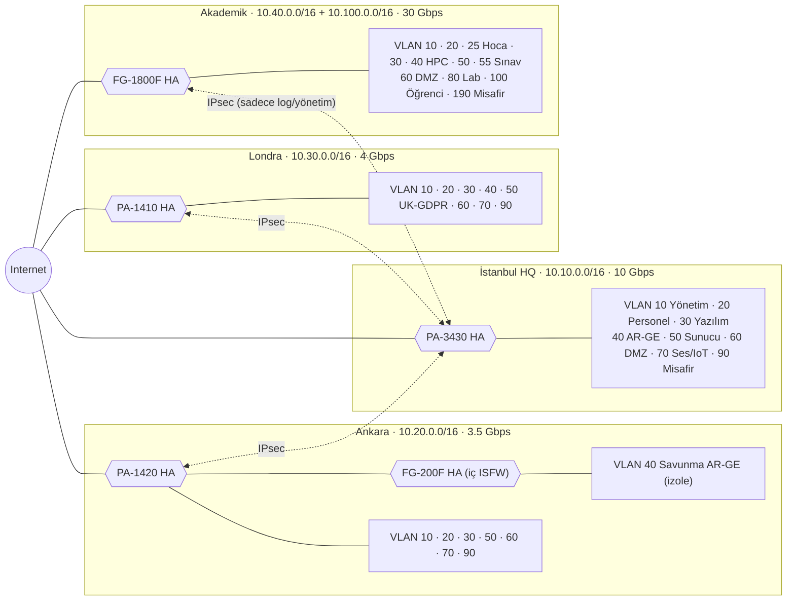
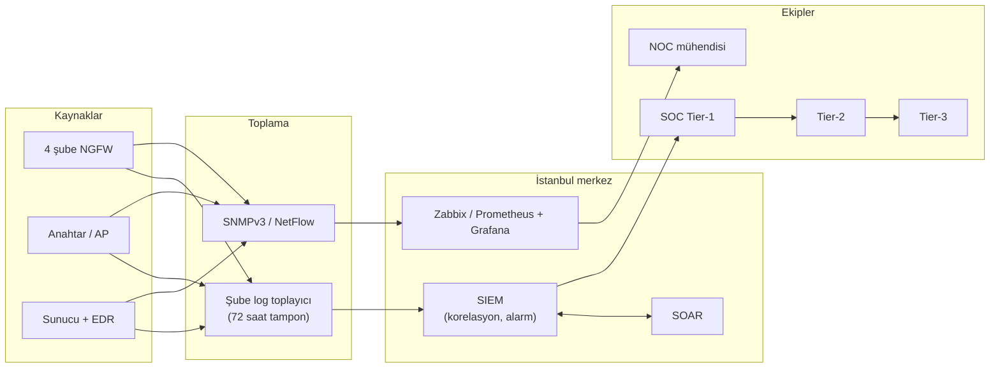

# Vize Projesi – Kurumsal Ağ Tasarımı: Bant Genişliği ve Güvenlik Duvarları

> Bu depo, AegisNova Global için bant genişliği hesabını, VLAN bölünmesini, şube bazlı en uygun güvenlik duvarlarını, kural setlerini ve izleme (monitoring) yapısını içerir. Şube bazlı tam kural setleri ve cihaz konfigürasyonları şube klasörlerindedir (`01-` … `04-`).

## 1. Senaryo: AegisNova Global Teknoloji ve Eğitim A.Ş.

Kurgusal şirketimiz AegisNova Global; İstanbul genel merkezi, Ankara ve Londra ofisleri ve bir akademik kampüsten oluşur. Toplam **11.425 kullanıcının 10.000'i öğrencidir**. Amaç, her birime ihtiyacına göre bant genişliği vermek ve tüm şubeleri tek bir güvenlik politikasıyla korumaktır.

| Şube | İdari | Hoca | Öğrenci | Yazılım | Teknik | Güvenlik | AR-GE | Toplam | Gerekli (formül) | Ana + yedek hat | Seçilen NGFW (HA) |
| --- | ---: | ---: | ---: | ---: | ---: | ---: | ---: | ---: | ---: | --- | --- |
| [İstanbul](02-istanbul-ofisi/README.md) | 180 | 0 | 0 | 140 | 30 | 15 | 65 | **430** | 4,85 Gbps | 5 + 5 Gbps | Palo Alto PA-3430 |
| [Ankara](01-ankara-ofisi/README.md) | 65 | 0 | 0 | 85 | 17 | 8 | 55 | **230** | 2,41 Gbps | 2,5 + 1 Gbps | Palo Alto PA-1420 + FortiGate 200F (iç) |
| [Londra](03-londra-ofisi/README.md) | 45 | 0 | 0 | 50 | 10 | 5 | 25 | **135** | 1,67 Gbps | 2 + 2 Gbps | Palo Alto PA-1410 |
| [Akademik Şube](04-akademik-sube/README.md) | 190 | 320 | 10.000 | 35 | 30 | 10 | 45 | **10.630** | 24,46 Gbps | 20 + 10 Gbps | FortiGate 1800F |
| **Toplam** | **480** | **320** | **10.000** | **310** | **87** | **38** | **190** | **11.425** | **33,40 Gbps** | **29,5 + 18 Gbps** | |

Teknik: ağ ve sistem yönetimi (IT/NOC). Güvenlik: SOC analistleri ve güvenlik mühendisleri. Yazılım ve AR-GE ekiplerinin dört şubedeki ayrıntısı: [05-yazilim-ekibi](05-yazilim-ekibi/README.md), [06-arge-ekibi](06-arge-ekibi/README.md).
Varsayımlar: her şubenin kendi internet çıkışı vardır, şubeler şifreli VPN ile birbirine bağlıdır, merkezi sunucular (ERP, e-posta, SIEM) İstanbul'dadır.

## 2. Ağ Topolojisi ve VLAN / IP Planı

Mimari hub-and-spoke (yıldız) modelidir: İstanbul merkezdir, Ankara ve Londra ona IPsec VPN ile bağlanır. Akademik şube yalnızca log ve yönetim trafiği için merkeze tünel açar; 10.000 öğrencinin ağı VPN'e **dahil edilmez**.



### İstanbul – 10.10.0.0/16

| VLAN | Alt ağ | Kullanım |
| ---: | --- | --- |
| 10 | 10.10.10.0/24 | Yönetim (firewall, switch, SOC) – 45 teknik |
| 20 | 10.10.20.0/23 | İdari personel – 180 |
| 30 | 10.10.30.0/23 | Yazılım ekibi – 140 |
| 40 | 10.10.40.0/24 | AR-GE – 65 |
| 50 | 10.10.50.0/24 | Veri merkezi (AD, ERP, GitLab, SIEM) |
| 60 | 10.10.60.0/24 | DMZ (WAF, API, VPN) |
| 70 | 10.10.70.0/23 | VoIP ve IoT |
| 90 | 172.16.10.0/23 | Misafir ve stajyer |

### Ankara – 10.20.0.0/16

| VLAN | Alt ağ | Kullanım |
| ---: | --- | --- |
| 10 | 10.20.10.0/24 | Yönetim – 25 teknik |
| 20 | 10.20.20.0/24 | İdari ve proje personeli – 65 |
| 30 | 10.20.30.0/24 | Yazılım ekibi – 85 |
| 40 | 10.20.40.0/24 | Savunma AR-GE – 55 (FG-200F arkasında, internete kapalı) |
| 50 | 10.20.50.0/24 | Yerel sunucular (RODC, paket aynası, log) |
| 60 | 10.20.60.0/24 | Kamu B2B VPN geçidi (DMZ) |
| 70 | 10.20.70.0/24 | VoIP ve geçiş kontrol |
| 90 | 172.16.20.0/24 | Misafir |

### Londra – 10.30.0.0/16

| VLAN | Alt ağ | Kullanım |
| ---: | --- | --- |
| 10 | 10.30.10.0/24 | Yönetim – 15 teknik |
| 20 | 10.30.20.0/24 | İdari, satış, hukuk – 45 |
| 30 | 10.30.30.0/24 | Bulut yazılım / SRE – 50 |
| 40 | 10.30.40.0/24 | FinTech AR-GE – 25 |
| 50 | 10.30.50.0/24 | UK-GDPR veri sunucuları |
| 60 | 10.30.60.0/24 | DMZ (GlobalProtect, API) |
| 70 | 10.30.70.0/24 | VoIP |
| 90 | 172.16.30.0/24 | Misafir |

### Akademik Şube – 10.40.0.0/16 ve 10.100.0.0/16

| VLAN | Alt ağ | Kullanım |
| ---: | --- | --- |
| 10 | 10.40.10.0/24 | Kampüs NOC – 40 teknik |
| 20 | 10.40.20.0/23 | İdari personel – 190 |
| 25 | 10.40.24.0/22 | Hocalar – 320 |
| 30 | 10.40.30.0/24 | Kampüs yazılım – 35 |
| 40 | 10.40.40.0/24 | Akademik AR-GE ve HPC – 45 |
| 50 | 10.40.50.0/24 | Veri merkezi (OBS veritabanı, RADIUS, 5651 log) |
| 55 | 10.40.52.0/22 | Dijital sınav salonları (internete kapalı) |
| 60 | 10.40.60.0/24 | DMZ (LMS, OBS portalı, WAF) |
| 80 | 10.40.80.0/21 | Bilgisayar laboratuvarları |
| 100 | 10.100.0.0/16 | Öğrenci Wi-Fi (65.534 adres) |
| 190 | 172.16.40.0/22 | Konferans ve misafir |

Öğrenci ağı için /16 seçilmesinin nedeni: 10.000 öğrenci ortalama 1,8 cihaz taşır, pikte yaklaşık 11.700 cihaz aktiftir. Daha küçük bir blok bu sayıya yetmez.

## 3. Bant Genişliği Hesabı ve Dağıtımı

Her grup için aşağıdaki formül kullanılır; sonuca protokol ek yükü (IPsec/TLS) ve büyüme payı eklenir:

```latex
B_{toplam} = \left( \sum_i N_i \times C_i \times M_i \times b_i \right) \times (1 + O_{encap}) \times (1 + H_{burst})
```

N = kişi sayısı, C = eşzamanlılık oranı, M = kişi başı cihaz çarpanı, b = cihaz başı ortalama hız (Mbps), O = ek yük (%12; akademikte %10), H = büyüme payı (%30; akademikte %25).

| Rol | C | M | b (Mbps) | Kişi başı pik | Baskın trafik |
| --- | ---: | ---: | ---: | ---: | --- |
| İdari personel | %65 | 1,2 | 2,5 | 1,95 | ERP, SaaS, VoIP |
| Yazılım ekibi | %85 | 1,5 | 6,0 | 7,65 | Git, CI/CD, konteyner imajları |
| AR-GE ekibi | %85 | 1,6 | 8,0 | 10,88 | Veri setleri, model dosyaları |
| Teknik / IT | %80 | 1,5 | 5,0 | 6,00 | Yama, log, uzaktan erişim |
| Hoca | %75 | 1,5 | 3,5 | 3,94 | Akademik veri tabanları, canlı ders |
| Öğrenci | %65 | 1,8 | 1,7 | 1,99 | LMS, web, Wi-Fi |

| Şube / Grup | Hesap | Sonuç |
| --- | --- | ---: |
| İstanbul – İdari | 180 × 1,95 | 351 Mbps |
| İstanbul – Yazılım | 140 × 7,65 | 1.071 Mbps |
| İstanbul – AR-GE | 65 × 10,88 | 707 Mbps |
| İstanbul – Teknik/SOC | 45 × 6,00 | 270 Mbps |
| İstanbul – Veri merkezi + DMZ + VPN hub | sabit tahmin | 850 Mbps |
| İstanbul – Misafir | sabit tahmin | 80 Mbps |
| **İstanbul toplam** | 3.329 × 1,12 × 1,30 = 4.847 Mbps | **2 × 5 Gbps = 10 Gbps** |
| Ankara – İdari | 65 × 1,95 | 127 Mbps |
| Ankara – Yazılım | 85 × 7,65 | 650 Mbps |
| Ankara – Savunma AR-GE | 55 kişi, vekil/ayna üzerinden | 440 Mbps |
| Ankara – Teknik | 25 × 6,00 | 150 Mbps |
| Ankara – Kamu B2B VPN + HQ replikasyon | sabit tahmin | 250 Mbps |
| Ankara – Misafir | sabit tahmin | 40 Mbps |
| **Ankara toplam** | 1.657 × 1,12 × 1,30 = 2.413 Mbps | **2,5 Gbps ana + 1 Gbps yedek = 3,5 Gbps** |
| Londra – İdari/Satış/Hukuk | 45 × 1,95 | 88 Mbps |
| Londra – Bulut yazılım / SRE | 50 × 9,0 | 450 Mbps |
| Londra – FinTech AR-GE | 25 × 10,88 | 272 Mbps |
| Londra – Teknik | 15 × 6,00 | 90 Mbps |
| Londra – API geçidi + HQ VPN | sabit tahmin | 220 Mbps |
| Londra – Misafir | sabit tahmin | 30 Mbps |
| **Londra toplam** | 1.150 × 1,12 × 1,30 = 1.674 Mbps | **2 × 2 Gbps = 4 Gbps** |
| Akademik – Öğrenci | pikte 6.500 aktif öğrenci (~11.700 cihaz) | 13.000 Mbps |
| Akademik – Hoca | 320 × 3,94 | 1.261 Mbps |
| Akademik – İdari | 190 × 1,95 | 371 Mbps |
| Akademik – Yazılım | 35 × 7,65 | 268 Mbps |
| Akademik – AR-GE / HPC | 45 kişi | 900 Mbps |
| Akademik – Teknik / NOC | 40 × 6,00 | 240 Mbps |
| Akademik – DMZ (LMS, OBS) | sabit tahmin | 1.500 Mbps |
| Akademik – Misafir / konferans | sabit tahmin | 250 Mbps |
| **Akademik toplam** | 17.790 × 1,10 × 1,25 = 24.461 Mbps | **20 Gbps ULAKNET + 10 Gbps ISP = 30 Gbps** |

Toplam kurulu kapasite 47,5 Gbps'tir. Her şubede en az iki hat vardır; tek hat koptuğunda bile pik yük taşınır (örneğin İstanbul'da tek 5 Gbps ≥ 4,85 Gbps).

### Bant genişliğini uygulamak (QoS / Traffic Shaping)

Hat satın almak yetmez; güvenlik duvarında trafik sınıflara ayrılır, her sınıfa garanti ve tavan değeri verilir.

| Sınıf | Örnek trafik | DSCP | Garanti | Tavan |
| --- | --- | --- | ---: | ---: |
| 1 – Gerçek zamanlı | VoIP, canlı ders | EF | %10 | %20 |
| 2 – Ağ kontrol | BGP, IKE, SIEM logu | CS6 | %5 | %15 |
| 3 – İş kritik / sınav | ERP, OBS, LMS, B2B VPN | AF41 | %25 | %60 |
| 4 – Yazılım ve AR-GE | Git, CI/CD, akademik veri tabanı | AF31 | %25 | %70 |
| 5 – Kurumsal standart | Web, e-posta, bulut ofis | AF21 | %15 | %50 |
| 6 – Öğrenci genel internet | Wi-Fi, genel web | BE | %15 | %55 |
| 7 – Yedek ve yama | Yedekleme, güncelleme | AF11 | %5 | %25 |
| 8 – Misafir | Misafir Wi-Fi, eğitim dışı akış | CS1 | %0 | %10 |

Kişi başı limitler:

- Öğrenci: 15 Mbps indirme / 8 Mbps yükleme, en fazla 400 eşzamanlı oturum; P2P/torrent engelli.
- Misafir: 5 Mbps (Londra, İstanbul, Ankara'da 4–5 Mbps), kişi başı oturum sınırı.
- Hoca ve personel: kişi başı limit yok, sınıf limitleri geçerli.
- Öğrenci NAT havuzu: 512 portluk blok tahsisi (PBA CGNAT); her blok zaman damgalı loglanır.

## 4. Adım Adım Güvenlik Duvarı Kurulumu

Kurulum dört şubede aynı sırayla uygulanır: fiziksel kurulum → sertleştirme → HA → LACP/VLAN/bölgeler → ISP/SD-WAN/QoS → VPN → kimlik ve SSL inceleme → kurallar, NAT ve log → test ve devreye alma. Tüm adımlar: [KURULUM.md](KURULUM.md). Şubeye özel adımlar ve kabul testleri her şubenin `kurulum-adimlari.md` dosyasındadır.
## 5. Bölgeler Arası Politika Özeti

| Kural | Uygulama |
| --- | --- |
| Varsayılan | Tüm bölgelerde `deny all + log` |
| Öğrenci → iç ağ | Yasak; yalnızca DMZ'deki LMS/OBS'ye HTTPS |
| Sınav salonu → internet | Yasak; yalnızca yerel sınav sunucusu |
| Savunma AR-GE (Ankara) → internet | Yasak; yalnızca yerel imzalı paket aynası |
| AR-GE (İstanbul) → internet | Yasak; yalnızca iç vekil sunucu (8443) |
| Londra UK-GDPR sunucuları → yurt dışı | Veritabanı/dosya aktarımı yasak; yalnızca maskeli log |
| Misafir → iç ağlar | Yasak; yalnızca internet |

## 6. Şube Bazlı Güvenlik Duvarı Kuralları

Kurallar yukarıdan aşağıya işlenir, ilk eşleşme geçerlidir; her tablonun son satırı "hepsini reddet" kuralıdır. Tam kural setleri ve cihaz komutları: [İstanbul](02-istanbul-ofisi/firewall-kurallari.md), [Ankara](01-ankara-ofisi/firewall-kurallari.md), [Londra](03-londra-ofisi/firewall-kurallari.md), [Akademik](04-akademik-sube/firewall-kurallari.md).

### İstanbul (PA-3430)

| # | Kaynak | Hedef | Servis | İşlem | Not |
| ---: | --- | --- | --- | --- | --- |
| 1 | Dış ağ | Her yer | Tehdit listesi (USOM, Tor, C2) | Reddet | Dinamik liste |
| 2 | Yönetim VLAN 10 | Tüm cihaz yönetimi | SSH, HTTPS | İzin | Yalnızca SOC, MFA |
| 3 | Şube VPN'leri | SIEM (10.10.50.25) | Syslog TLS 6514 | İzin | Log toplama |
| 4 | Personel VLAN 20 | Sunucu VLAN 50 | ERP, AD, DNS | İzin | |
| 5 | Personel VLAN 20 | Yazılım, AR-GE | Hepsi | Reddet | Yanal hareket |
| 6 | Yazılım VLAN 30 | GitLab / Harbor | SSH, HTTPS | İzin | Yalnızca yazılım grubu |
| 7 | AR-GE VLAN 40 | İç vekil sunucu | HTTPS 8443 | İzin | DLP ile |
| 8 | AR-GE VLAN 40 | İnternet | Hepsi | Reddet | Doğrudan çıkış yok |
| 9 | Personel, Yazılım | İnternet | HTTP/HTTPS, DNS | İzin | Web filtre + QoS |
| 10 | Dış ağ | DMZ (WAF, GlobalProtect) | HTTPS 443 | İzin | IPS |
| 11 | DMZ | Uygulama katmanı | TCP 8443 | İzin | Doğrudan veritabanı yok |
| 12 | Misafir VLAN 90 | İç ağlar | Hepsi | Reddet | Yalnızca internet |
| 99 | Her yer | Her yer | Hepsi | Reddet + Logla | Varsayılan |

### Ankara (PA-1420 dış sınır + FG-200F iç ISFW)

| # | Kaynak | Hedef | Servis | İşlem | Not |
| ---: | --- | --- | --- | --- | --- |
| 1 | Dış ağ | Her yer | Sahte/zararlı IP | Reddet | |
| 2 | Kamu kurumları (beyaz liste) | DMZ B2B | IPsec, mTLS 8443 | İzin | |
| 3 | Yönetim, İstanbul SOC | Yerel sunucular | SSH, SNMPv3, syslog | İzin | |
| 4 | Yazılım VLAN 30 | İstanbul GitLab (VPN) | Git, SSH, HTTPS | İzin | |
| 5 | Savunma AR-GE VLAN 40 | Yerel RODC, DNS, NTP | LDAPS, Kerberos, DNS | İzin | ISFW |
| 6 | Savunma AR-GE VLAN 40 | İmzalı paket aynası | HTTPS 443 | İzin | Yükleme engelli (DLP) |
| 7 | Bastion (yönetim) | Savunma AR-GE | SSH (kayıtlı oturum) | İzin | 2FA |
| 8 | Diğer tüm VLAN'lar | Savunma AR-GE | Hepsi | Reddet | |
| 9 | Savunma AR-GE | İnternet ve her yer | Hepsi | Reddet + Logla | Hava boşluğuna yakın |
| 99 | Her yer | Her yer | Hepsi | Reddet + Logla | Varsayılan |

### Londra (PA-1410)

| # | Kaynak | Hedef | Servis | İşlem | Not |
| ---: | --- | --- | --- | --- | --- |
| 1 | Dış ağ | Her yer | NCSC / C2 / Tor listesi | Reddet | |
| 2 | UK-GDPR VLAN 50 | İstanbul, internet | PostgreSQL, MySQL, SMB, FTP, rsync | Reddet | Sınır ötesi veri kilidi, DPO alarmı |
| 3 | Maskeli log toplayıcı | İstanbul SIEM | Syslog TLS 6514 | İzin | Kimlikler maskeli |
| 4 | Yazılım VLAN 30 | AWS London VPC | SSH, HTTPS, Kubernetes | İzin | DLP: API anahtarı sızıntısı |
| 5 | Yazılım VLAN 30 | İstanbul GitLab | Git, SSH | İzin | |
| 6 | AR-GE VLAN 40 | Onaylı sandbox adresleri | HTTPS | İzin | DLP: finansal kişisel veri |
| 7 | AR-GE VLAN 40 | İnternet (diğer) | Hepsi | Reddet | |
| 8 | Personel VLAN 20 | İnternet | Office 365, CRM, web | İzin | Kişisel bulut yükleme engelli |
| 9 | Uzaktan çalışanlar | DMZ GlobalProtect | HTTPS | İzin | MFA, cihaz sağlığı kontrolü |
| 10 | Misafir VLAN 90 | İnternet | HTTP/HTTPS, DNS | İzin | 5 Mbps |
| 99 | Her yer | Her yer | Hepsi | Reddet + Logla | Varsayılan |

### Akademik Şube (FortiGate 1800F)

| # | Kaynak | Hedef | Servis | İşlem | Not |
| ---: | --- | --- | --- | --- | --- |
| 1 | Dış ağ | Her yer | Botnet, sahte IP | Reddet | DoS koruma |
| 2 | Kampüs NOC | Veri merkezi, DMZ, İstanbul SOC | SSH, HTTPS, SNMPv3, syslog | İzin | 2FA |
| 3 | Öğrenci, Lab, Misafir | İdari, Hoca, Veri merkezi, AR-GE, İstanbul | Hepsi | Reddet | İç tarama alarmı |
| 4 | Sınav VLAN 55 | Sınav sunucusu (10.40.60.50) | HTTPS 443 | İzin | |
| 5 | Sınav VLAN 55 | İnternet ve her yer | Hepsi | Reddet + Alarm | |
| 6 | Öğrenci, Lab | DMZ (WAF → LMS/OBS) | HTTPS 443 | İzin | OWASP, hız sınırı |
| 7 | Öğrenci, Lab | İnternet | BitTorrent, P2P, Tor, proxy, kripto madenciliği, SMB | Reddet | Uygulama kontrolü |
| 8 | Öğrenci VLAN 100 | İnternet | HTTP/HTTPS, DNS, QUIC | İzin | 15/8 Mbps, 400 oturum, CGNAT, 5651 |
| 9 | Hoca VLAN 25 | DMZ, veri merkezi, ULAKNET | HTTPS, SSH, canlı ders | İzin | Garantili 2 Gbps |
| 10 | İdari VLAN 20 | Veri merkezi, internet | HTTPS, LDAPS, ERP | İzin | DLP: öğrenci kişisel verisi |
| 11 | AR-GE / HPC VLAN 40 | ULAKNET | HTTPS, SSH, GridFTP | İzin | |
| 12 | Misafir VLAN 190 | İnternet | HTTP/HTTPS, DNS | İzin | 5 Mbps |
| 99 | Her yer | Her yer | Hepsi | Reddet + Logla | Varsayılan |

## 7. Şubeler Arası VPN

Ankara ve Londra, İstanbul'a kalıcı IPsec tünelleriyle bağlanır; şubeler arası doğrudan trafik de İstanbul'dan geçer ve orada denetlenir. Akademik şube yalnızca yönetim ve log trafiğini (NOC ve SIEM alt ağları) İstanbul'a taşır.

| Tünel | Uç noktalar | Şifreleme | Yedek |
| --- | --- | --- | --- |
| VPN-1 | İstanbul ↔ Ankara | IKEv2, AES-256-GCM, SHA-384, DH 20 | Yedek hat üzerinden ikinci tünel |
| VPN-2 | İstanbul ↔ Londra | Aynı | İkinci ISP üzerinden ikinci tünel |
| VPN-3 | İstanbul ↔ Akademik | Aynı (yalnızca log/yönetim) | İkinci ISP üzerinden ikinci tünel |

## 8. Her Birim İçin En İyi 5 Güvenlik Duvarı

Seçimde belirleyici olan hat hızı değil, **IPS + uygulama kontrolü + antivirüs + SSL inceleme açıkken** cihazın taşıyabildiği trafiktir (threat protection throughput). Bu açıldığında verim, katalogdaki "firewall throughput" değerinin çok altına düşer. Bu yüzden kural şudur:

```latex
Gerekli\ kapasite \ge Hat\ bant\ genişliği \times 1,2 \text{ ila } 1,5
```

| Birim | Hat / trafik | Gerekli threat protection | Ek gereksinim |
| --- | --- | ---: | --- |
| Akademik Şube | 30 Gbps (pik 24,5) | ≥ 25 Gbps | 10.000 öğrenci, milyonlarca oturum, CGNAT, HA |
| İstanbul | 10 Gbps (pik 4,85) | ≥ 7 Gbps | VPN hub, DMZ, SSL inceleme, HA |
| Ankara dış sınır | 3,5 Gbps (pik 2,41) | ≥ 3,5 Gbps | Kamu B2B tünelleri, HA |
| Ankara savunma AR-GE (iç) | 10 Gbps iç trafik | ≥ 3 Gbps | Farklı üretici, 10G SFP+ |
| Londra | 4 Gbps (pik 1,67) | ≥ 3 Gbps | UK-GDPR DLP, bulut entegrasyonu |
| Yazılım ekibi (bulut/konteyner) | 310 kişi | Sanal, ölçeklenebilir | Kubernetes, CI/CD, WAF |

Modeller yaklaşık sınıf göstergesidir; satın almadan önce üreticinin güncel veri sayfası doğrulanmalıdır.

### Akademik Şube

| # | Model | Threat protection | SSL inceleme | Oturum | Karar |
| ---: | --- | ---: | ---: | ---: | --- |
| 1 | **Fortinet FortiGate 1800F (HA)** | 31 Gbps | ~20 Gbps | 12 milyon | **Seçildi** |
| 2 | Palo Alto PA-5420 | 30,2 Gbps | ~19,5 Gbps | 5,7 milyon | Oturum kapasitesi yarı, maliyet yüksek |
| 3 | Check Point Quantum 16200 | 24 Gbps | ~16 Gbps | 10 milyon | Pik yükte darboğaz |
| 4 | Juniper SRX4600 | 22 Gbps | ~14,5 Gbps | 20 milyon | 30 Gbps hattın gerisinde |
| 5 | Cisco Secure Firewall 4115 | 21,4 Gbps | ~12 Gbps | 15 milyon | SSL kapasitesi yetersiz |

FortiGate 1800F'in NP7 işlemcisi, donanım hızlandırmalı CGNAT ve 12 milyon oturum sunar; 10.000 öğrencilik kampüste asıl risk NAT portu ve oturum tablosu tükenmesidir.

### İstanbul

| # | Model | Threat protection | SSL inceleme | Oturum | Karar |
| ---: | --- | ---: | ---: | ---: | --- |
| 1 | **Palo Alto PA-3430 (HA)** | 12,7 Gbps | ~8,5 Gbps | 3 milyon | **Seçildi** |
| 2 | Fortinet FortiGate 600F | 10,5 Gbps | 9 Gbps | 8 milyon | Dış sınırda geçmiş SSL-VPN açıkları |
| 3 | Check Point Quantum 6700 | 7,6 Gbps | ~5,8 Gbps | 4 milyon | 10 Gbps hat için dar |
| 4 | Cisco Secure Firewall 3130 | 15,2 Gbps | ~6,4 Gbps | 4 milyon | Yönetim (FMC) yükü, günlük kural değişimi yavaş |
| 5 | Sophos XGS 5500 | 14 Gbps | 13,5 Gbps | 18 milyon | Büyük ölçekli BGP/SOC entegrasyonu zayıf |

PA-3430; App-ID, User-ID, WildFire ve Panorama ile İstanbul, Ankara ve Londra güvenlik duvarlarını tek yerden yönetmeyi sağlar.

### Ankara dış sınır

| # | Model | Threat protection | SSL inceleme | Karar |
| ---: | --- | ---: | ---: | --- |
| 1 | **Palo Alto PA-1420 (HA)** | 4,8 Gbps | ~3,2 Gbps | **Seçildi** (Panorama uyumu) |
| 2 | Fortinet FortiGate 400F | 9 Gbps | 8 Gbps | Panorama ortak şablonunu bozar |
| 3 | Check Point Quantum 6400 | 3,9 Gbps | ~2,9 Gbps | SSL altında 3,5 Gbps hatta sınırda |
| 4 | Cisco Secure Firewall 3110 | 8,9 Gbps | ~3,8 Gbps | Tek şube için ayrı FMC maliyeti |
| 5 | WatchGuard Firebox M690 | 3,4 Gbps | 2,9 Gbps | Savunma B2B'de uygulama imzası yetersiz |

### Ankara savunma AR-GE iç segmentasyon (ISFW)

| # | Model | Threat protection | Karar |
| ---: | --- | ---: | --- |
| 1 | **Fortinet FortiGate 200F (HA)** | 3 Gbps | **Seçildi:** dışta Palo Alto, içte Fortinet; tek üretici zafiyetine karşı çift üretici |
| 2 | Palo Alto PA-460 | 2,4 Gbps | Dış sınırla aynı üretici, 10G SFP+ yok |
| 3 | Cisco Secure Firewall 1220CX | 4,5 Gbps | Ek yönetim konsolu yükü |
| 4 | Check Point Quantum 3800 | 1,5 Gbps | Büyük imaj aktarımında darboğaz |
| 5 | Netgate 8200 (pfSense Plus) | ~1,8 Gbps | Garantili yerinde yedek parça ve sertifikalı donanım yok |

### Londra

| # | Model | Threat protection | SSL inceleme | Karar |
| ---: | --- | ---: | ---: | --- |
| 1 | **Palo Alto PA-1410 (HA)** | 3,5 Gbps | ~2,5 Gbps | **Seçildi:** yerleşik DLP, UK-GDPR |
| 2 | Fortinet FortiGate 200F | 3 Gbps | 4 Gbps | Panorama standardını bozar |
| 3 | Juniper SRX1600 | 4,6 Gbps | ~3,1 Gbps | SaaS görünürlüğü ve DLP zayıf |
| 4 | Cisco Secure Firewall 1220CX | 4,5 Gbps | ~2,2 Gbps | Düşük oturum tablosu, ayrı konsol |
| 5 | Check Point Quantum 6200 | 2,5 Gbps | ~1,8 Gbps | SSL altında büyüme payı yok |

### Yazılım ekibi (bulut / konteyner katmanı)

| # | Çözüm | Karar |
| ---: | --- | --- |
| 1 | **Palo Alto VM-Series / CN-Series + Cloudflare WAF** | **Seçildi:** Panorama ile aynı kurallar, Kubernetes pod seviyesinde görünürlük |
| 2 | Fortinet FortiGate-VM + FortiWeb | Akademik şube LMS/OBS önünde WAF olarak kullanılır |
| 3 | AWS Network Firewall + AWS WAF | Yalnızca AWS'de çalışır, çoklu bulutu kapsamaz |
| 4 | Check Point CloudGuard Network | Panorama ekosistemine uymaz |
| 5 | Tigera Calico Enterprise (eBPF) | Kubernetes içi çok hızlı ama tam NGFW değil, yardımcı katman |

### Neden L3 anahtar ACL'i, Linux nftables veya pfSense/OPNsense ana omurgada değil?

1. ACL durumsuzdur ve yalnızca IP/port görür; TCP 443 üzerinden tünel açan zararlıyı ayırt edemez.
2. Donanım hızlandırması yoktur; 30 Gbps'te IPS ve SSL inceleme açıldığında CPU darboğazı ve paket kaybı oluşur.
3. Kimlik farkındalığı zayıftır: kural IP'ye değil "Yazılım Grubu" veya "Öğrenci Rolü"ne yazılmalıdır.
4. WildFire/FortiGuard gibi küresel tehdit istihbaratı ve sıfır-gün korumasının açık kaynak karşılığı aynı hızda güncellenmez.
5. 11.425 kişilik yapıda 4 saatte yerinde parça değişimi (RMA) ve ISO 27001 / KVKK / UK-GDPR denetiminin istediği sertifikalı donanım gerekir.

## 9. Monitoring: Sistem ve İnsan

Profesyonel dünyada izleme iki merkezde yapılır: **NOC** ağın ayakta olup olmadığını, **SOC** saldırı olup olmadığını izler. AegisNova'da merkez SOC/NOC İstanbul'dadır; 7/24 üç vardiya çalışır ve diğer şubelerin yerel teknik ekipleriyle entegredir.



### Sistem tarafı

| Katman | Araç | Ne izlenir |
| --- | --- | --- |
| Cihaz sağlığı | Zabbix / Prometheus, SNMPv3 | Açık/kapalı, CPU, bellek, sıcaklık, PSU, HA durumu |
| Bant genişliği | NetFlow/IPFIX analizörü | Hat doluluğu, kim ne kadar kullanıyor |
| Log ve SIEM | Elastic / Splunk, Syslog TLS 6514 | Merkezi toplama, korelasyon, alarm |
| Saldırı tespiti | Suricata / NDR | Ağ içi şüpheli davranış |
| Uç nokta | EDR | Bilgisayar ve sunucudaki zararlı aktivite |
| Güvenlik duvarı yönetimi | Panorama, FortiManager | Kural değişikliği takibi, atıl ve gölgelenmiş kural tespiti |
| Pano | Grafana | NOC ekranında canlı durum |
| Otomasyon | SOAR | Saldırgan IP'yi tüm şubelerde dinamik listeyle engelleme |

Örnek alarm eşikleri:

| Olay | Eşik | Öncelik | Kim ilgilenir |
| --- | --- | --- | --- |
| VPN tüneli kopması | 1 dakika | Kritik | NOC |
| HA senkron kaybı | 1 dakika | Kritik | NOC |
| Hat doluluğu | %80 üstü, 15 dk | Yüksek | NOC |
| Firewall veri düzlemi CPU | %85 üstü, 2 dk | Yüksek | NOC |
| Oturum tablosu doluluğu | %80 üstü | Kritik | NOC / SOC |
| Başarısız yönetici girişi | 5 deneme / 5 dk | Kritik | SOC Tier-1 |
| Öğrenci ağından iç ağa erişim denemesi | 15 engel / 1 dk | Orta | SOC Tier-1 |
| AR-GE bölgesinden internete çıkış denemesi | 1 olay | Kritik | SOC Tier-2 |
| UK-GDPR sunucularından yurt dışına veri aktarımı | 1 olay | Kritik | SOC Tier-2 + DPO |
| 5651 zaman damgası servisi yanıtsız | 15 dk | Kritik | Uyum ekibi |

Yasal izleme: Türkiye şubelerinde 5651 kapsamında IP–port–kullanıcı eşleşmesi saatlik özetlenir ve zaman damgasıyla 2 yıl saklanır; Londra'da kimlikler UK-GDPR gereği maskelenir.

### İnsan tarafı

| Rol | Görev | Hedef süre |
| --- | --- | --- |
| NOC mühendisi | Hat, donanım, VPN, BGP arızaları | İlk tespit < 5 dk |
| SOC Tier-1 analist | Alarm triyajı, yanlış pozitifleri ayıklama | Üstlenme < 10 dk |
| SOC Tier-2 uzman | Gerçek olay inceleme, izolasyon | Çevreleme < 45 dk |
| SOC Tier-3 / tehdit avcısı | Karmaşık saldırı analizi, proaktif av | Haftalık av döngüsü |
| SOC yöneticisi / CISO | Kriz yönetimi, yasal bildirim (KVKK, USOM, UK ICO), raporlama | Kritik olayda 15 dk |
| Güvenlik duvarı yöneticisi | Kural değişikliği, yama, yedek | Talep başına |

7/24 tek koltuk için yaklaşık 5 kişi gerekir (168 saat ÷ 40 saat = 4,2 kişi + izin payı).

Süreçler:

1. **Olay müdahalesi (NIST SP 800-61):** Hazırlık → Tespit ve analiz → Çevreleme, temizleme, kurtarma → Olay sonrası.
2. **Playbook:** Her olay türü için adımlar yazılıdır (fidye yazılımı, DDoS, çift hat kesintisi, AR-GE ihlali).
3. **Değişiklik yönetimi ve 4 göz ilkesi:** Kuralı hazırlayan ve yayınlayan kişi farklıdır; geçici kurallara bitiş tarihi verilir.
4. **Alarm yorgunluğu:** Vardiya başına yüksek öncelikli alarm sayısı sınırlanır; gürültülü kurallar haftalık gözden geçirilir; tekrarlayan sorgular SOAR ile otomatik zenginleştirilir.
5. **KPI:** MTTD < 5 dk, MTTA < 10 dk, MTTR < 45 dk, yanlış pozitif oranı < %15, hat ve VPN erişilebilirliği %99,9.
6. **Tatbikat:** Üç ayda bir masa başı ve mor ekip tatbikatı, yılda bir sızma testi; akademik ağ en yüksek önceliktir.
7. **Uyum:** ISO 27001, KVKK, UK-GDPR (ihlal bildirimi 72 saat); saldırı teknikleri MITRE ATT&CK ile eşlenir.

## 10. Sonuç

AegisNova tasarımında her şubeye hesaplanan ihtiyacına göre hat verildi (toplam 47,5 Gbps), trafik QoS sınıflarıyla önceliklendirildi ve dört şube de "varsayılan reddet" ilkesiyle çalışan, HA çiftli NGFW'lerle korundu.

En kritik üç nokta:

1. 10.000 öğrencilik akademik ağın diğer tüm ağlardan yalıtılması ve sınav trafiğinin her koşulda önceliklendirilmesi.
2. Ankara savunma AR-GE bölgesinin farklı üreticili bir iç güvenlik duvarıyla internetten tamamen ayrılması.
3. Güvenlik duvarının tek başına yetmemesi: ağ için NGFW, web uygulamaları için WAF ve izleme için 7/24 SOC birlikte kullanılmalıdır (derinlemesine savunma).

## 11. Klasör Yapısı

```text
firewallödev/
├── README.md                  → Projenin özeti ve ana rapor (bu dosya)
├── KURULUM.md                 → Her şubede ortak kurulum adımları
├── IZLEME.md                  → İzleme: sistematik kısım ve insan kısmı (ayrıntılı)
├── RISKLER.md                 → Her şubede neyi, neden, nasıl koruyoruz
├── SENARYOLAR.md              → Sistemin gerçek olaylarda nasıl çalıştığı
├── SOZLUK.md                  → Terimlerin açıklamaları
├── KAYNAKLAR.md               → Cihaz hızlarının ve mevzuatın kaynakları
│
├── 01-ankara-ofisi/
│   ├── README.md              → Kişi sayıları, VLAN ve bant genişliği
│   ├── top5-firewall.md       → 5 aday güvenlik duvarı ve seçim
│   ├── kurulum-adimlari.md    → Şubeye özel kurulum ve testler
│   ├── firewall-kurallari.md  → Şubenin kural seti
│   └── configs/               → Cihaz konfigürasyonları
├── 02-istanbul-ofisi/         → (aynı yapı)
├── 03-londra-ofisi/           → (aynı yapı)
├── 04-akademik-sube/          → (aynı yapı)
├── 05-yazilim-ekibi/          → README, top5-firewall, kurulum-adimlari
└── 06-arge-ekibi/             → README, top5-firewall, kurulum-adimlari
```

Ayrıntılı belgeler: [Kurulum](KURULUM.md) · [İzleme](IZLEME.md) · [Riskler](RISKLER.md) · [Senaryolar](SENARYOLAR.md) · [Sözlük](SOZLUK.md) · [Kaynaklar](KAYNAKLAR.md)