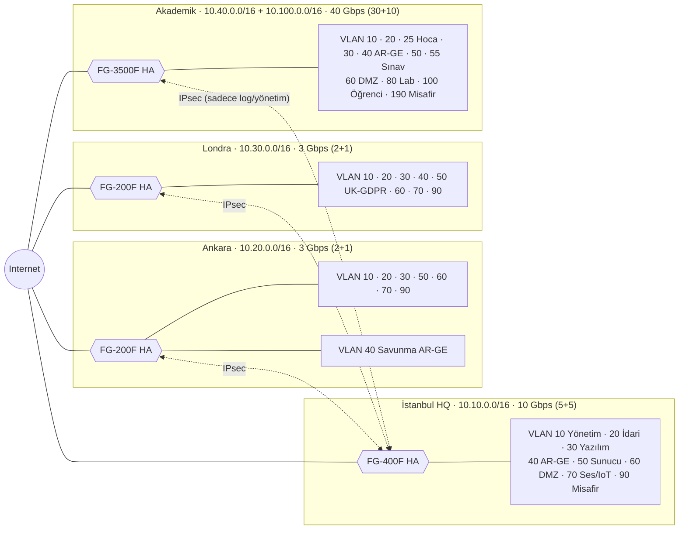
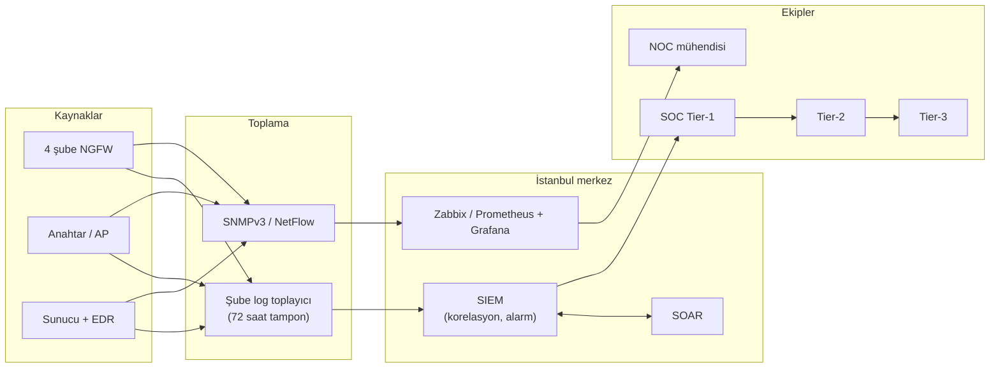

# Vize Projesi – Kurumsal Ağ Tasarımı: Bant Genişliği ve Güvenlik Duvarları

> Bu depo, Kalkan Bilişim için bant genişliği hesabını, VLAN bölünmesini, şube bazlı en uygun güvenlik duvarlarını, kural setlerini ve izleme (monitoring) yapısını içerir. Şube bazlı tam kural setleri ve cihaz konfigürasyonları şube klasörlerindedir (`01-` … `04-`).

## 1. Senaryo: Kalkan Bilişim ve Eğitim Teknolojileri A.Ş.

Kurgusal şirketimiz Kalkan Bilişim ve Eğitim Teknolojileri A.Ş.; İstanbul genel merkezi, Ankara ve Londra ofisleri ve bir akademik kampüsten oluşur. Toplam **11.600 kullanıcının 10.000'i öğrencidir**. Amaç, her birime ihtiyacına göre bant genişliği vermek ve tüm şubeleri tek bir güvenlik politikasıyla korumaktır.

### 4. Headcount, bandwidth and firewall matrix per branch

| Branch | Admin staff | Faculty | Students | Software | Technical | Security | R&D | Total | Required (formula) | Primary + backup link | Selected NGFW (HA) |
| :--- | :---: | :---: | :---: | :---: | :---: | :---: | :---: | :---: | :---: | :---: | :--- |
| [Istanbul Office](02-istanbul-ofisi/README.md) | 280 | 0 | 0 | 60 | 35 | 25 | 20 | **420** | 3.95 Gbps | 5 + 5 Gbps | **FortiGate 400F** |
| [Ankara Office](01-ankara-ofisi/README.md) | 140 | 0 | 0 | 30 | 20 | 15 | 15 | **220** | 1.50 Gbps | 2 + 1 Gbps | **FortiGate 200F** |
| [London Office](03-londra-ofisi/README.md) | 135 | 0 | 0 | 30 | 18 | 15 | 12 | **210** | 1.35 Gbps | 2 + 1 Gbps | **FortiGate 200F** |
| [Academic Branch](04-akademik-sube/README.md) | 220 | 400 | 10,000 | 30 | 60 | 0 | 40 | **10,750** | 27.29 Gbps | 30 + 10 Gbps | **FortiGate 3500F** |
| **Total** | **775** | **400** | **10,000** | **150** | **133** | **55** | **87** | **11,600** | **34.09 Gbps** | **39 + 17 Gbps** | |

Varsayımlar: her şubenin kendi internet çıkışı vardır, şubeler şifreli VPN ile birbirine bağlıdır, merkezi sunucular (ERP, e-posta, SIEM) İstanbul'dadır.

## 2. Ağ Topolojisi ve VLAN / IP Planı

Mimari hub-and-spoke (yıldız) modelidir: İstanbul merkezdir, Ankara ve Londra ona IPsec VPN ile bağlanır. Akademik şube yalnızca log ve yönetim trafiği için merkeze tünel açar; 10.000 öğrencinin ağı VPN'e **dahil edilmez**.



### İstanbul – 10.10.0.0/16 (Toplam 420 Kullanıcı)

| VLAN | Alt ağ | Kullanım |
| ---: | --- | --- |
| 10 | 10.10.10.0/24 | Yönetim (firewall, switch, SOC) – 35 teknik + 25 güvenlik |
| 20 | 10.10.20.0/23 | İdari personel – 280 |
| 30 | 10.10.30.0/24 | Yazılım ekibi – 60 |
| 40 | 10.10.40.0/24 | AR-GE – 20 |
| 50 | 10.10.50.0/24 | Veri merkezi (AD, ERP, GitLab, SIEM) |
| 60 | 10.10.60.0/24 | DMZ (WAF, API, VPN) |
| 70 | 10.10.70.0/23 | VoIP ve IoT |
| 90 | 172.16.10.0/23 | Misafir ve stajyer |

### Ankara – 10.20.0.0/16 (Toplam 220 Kullanıcı)

| VLAN | Alt ağ | Kullanım |
| ---: | --- | --- |
| 10 | 10.20.10.0/24 | Yönetim – 20 teknik + 15 güvenlik |
| 20 | 10.20.20.0/24 | İdari ve proje personeli – 140 |
| 30 | 10.20.30.0/24 | Yazılım ekibi – 30 |
| 40 | 10.20.40.0/24 | Savunma AR-GE – 15 (internete kapalı, özel erişim) |
| 50 | 10.20.50.0/24 | Yerel sunucular (RODC, paket aynası, log) |
| 60 | 10.20.60.0/24 | Kamu B2B VPN geçidi (DMZ) |
| 70 | 10.20.70.0/24 | VoIP ve geçiş kontrol |
| 90 | 172.16.20.0/24 | Misafir |

### Londra – 10.30.0.0/16 (Toplam 210 Kullanıcı)

| VLAN | Alt ağ | Kullanım |
| ---: | --- | --- |
| 10 | 10.30.10.0/24 | Yönetim – 18 teknik + 15 güvenlik |
| 20 | 10.30.20.0/24 | İdari, satış, hukuk – 135 |
| 30 | 10.30.30.0/24 | Bulut yazılım / SRE – 30 |
| 40 | 10.30.40.0/24 | FinTech AR-GE – 12 |
| 50 | 10.30.50.0/24 | UK-GDPR veri sunucuları |
| 60 | 10.30.60.0/24 | DMZ (SSL-VPN, API) |
| 70 | 10.30.70.0/24 | VoIP |
| 90 | 172.16.30.0/24 | Misafir |

### Akademik Şube – 10.40.0.0/16 ve 10.100.0.0/16 (Toplam 10.750 Kullanıcı)

| VLAN | Alt ağ | Kullanım |
| ---: | --- | --- |
| 10 | 10.40.10.0/24 | Kampüs NOC – 60 teknik |
| 20 | 10.40.20.0/23 | İdari personel – 220 |
| 25 | 10.40.24.0/22 | Hocalar / Akademisyenler – 400 |
| 30 | 10.40.30.0/24 | Kampüs yazılım – 30 |
| 40 | 10.40.40.0/24 | Akademik AR-GE ve HPC – 40 |
| 50 | 10.40.50.0/24 | Veri merkezi (OBS veritabanı, RADIUS, 5651 log) |
| 55 | 10.40.52.0/22 | Dijital sınav salonları (internete kapalı) |
| 60 | 10.40.60.0/24 | DMZ (LMS, OBS portalı, WAF) |
| 80 | 10.40.80.0/21 | Bilgisayar laboratuvarları |
| 100 | 10.100.0.0/16 | Öğrenci Wi-Fi (10.000 öğrenci / 65.534 adres) |
| 190 | 172.16.40.0/22 | Konferans ve misafir |

Öğrenci ağı için /16 seçilmesinin nedeni: 10.000 öğrenci ortalama 1,8 cihaz taşır, pikte yaklaşık 11.700 cihaz aktiftir. Daha küçük bir blok bu sayıya yetmez.

## 3. Bant Genişliği Hesabı ve Dağıtımı

Her grup için aşağıdaki formül kullanılır; sonuca protokol ek yükü (IPsec/TLS) ve büyüme payı eklenir:

```latex
B_{toplam} = \left( \sum_i N_i \times C_i \times M_i \times b_i \right) \times (1 + O_{encap}) \times (1 + H_{burst})
```

N = kişi sayısı, C = eşzamanlılık oranı, M = kişi başı cihaz çarpanı, b = cihaz başı ortalama hız (Mbps), O = ek yük (%12; akademikte %10), H = büyüme payı (%30; akademikte %25).

| Rol | C | M | b (Mbps) | Kişi başı pik | Baskın trafik |
| --- | ---: | ---: | ---: | ---: | --- |
| İdari personel | %65 | 1,2 | 2,5 | 1,95 | ERP, SaaS, VoIP |
| Yazılım ekibi | %85 | 1,5 | 6,0 | 7,65 | Git, CI/CD, konteyner imajları |
| AR-GE ekibi | %85 | 1,6 | 8,0 | 10,88 | Veri setleri, model dosyaları |
| Teknik / IT | %80 | 1,5 | 5,0 | 6,00 | Yama, log, uzaktan erişim |
| Hoca | %75 | 1,5 | 3,5 | 3,94 | Akademik veri tabanları, canlı ders |
| Öğrenci | %65 | 1,8 | 1,7 | 1,99 | LMS, web, Wi-Fi |

| Şube / Grup | Hesap Detayı | Gerekli (Formül) | Tahsis Edilen Hat (Ana + Yedek) |
| --- | --- | ---: | --- |
| **İstanbul** (420 kişi) | İdari (280) + Yazılım (60) + Teknik/Güvenlik (60) + AR-GE (20) + DMZ/DC | **3,95 Gbps** | **5 + 5 Gbps = 10 Gbps** (FortiGate 400F HA) |
| **Ankara** (220 kişi) | İdari (140) + Yazılım (30) + Teknik/Güvenlik (35) + AR-GE (15) + Kamu B2B | **1,50 Gbps** | **2 + 1 Gbps = 3 Gbps** (FortiGate 200F HA) |
| **Londra** (210 kişi) | İdari (135) + Yazılım (30) + Teknik/Güvenlik (33) + AR-GE (12) + Bulut/API | **1,35 Gbps** | **2 + 1 Gbps = 3 Gbps** (FortiGate 200F HA) |
| **Akademik Şube** (10.750 kişi) | Öğrenci (10.000) + Hoca (400) + İdari (220) + Teknik (60) + AR-GE (40) + Yazılım (30) | **27,29 Gbps** | **30 + 10 Gbps = 40 Gbps** (FortiGate 3500F HA) |
| **Genel Toplam (11.600)** | Tüm şubeler ve kampüs toplam pik bant genişliği | **34,09 Gbps** | **39 + 17 Gbps = 56 Gbps** |

Her şubede aktif-yedek (veya aktif-aktif) hat yedekliliği mevcuttur; hatlardan biri kopsa dahi formülle hesaplanan gereken pik bant genişliği (Required formula) kesintisiz taşınır (örneğin İstanbul'da tek 5 Gbps ≥ 3,95 Gbps).

### Bant genişliğini uygulamak (QoS / Traffic Shaping)

Hat satın almak yetmez; güvenlik duvarında trafik sınıflara ayrılır, her sınıfa garanti ve tavan değeri verilir.

| Sınıf | Örnek trafik | DSCP | Garanti | Tavan |
| --- | --- | --- | ---: | ---: |
| 1 – Gerçek zamanlı | VoIP, canlı ders | EF | %10 | %20 |
| 2 – Ağ kontrol | BGP, IKE, SIEM logu | CS6 | %5 | %15 |
| 3 – İş kritik / sınav | ERP, OBS, LMS, B2B VPN | AF41 | %25 | %60 |
| 4 – Yazılım ve AR-GE | Git, CI/CD, akademik veri tabanı | AF31 | %25 | %70 |
| 5 – Kurumsal standart | Web, e-posta, bulut ofis | AF21 | %15 | %50 |
| 6 – Öğrenci genel internet | Wi-Fi, genel web | BE | %15 | %55 |
| 7 – Yedek ve yama | Yedekleme, güncelleme | AF11 | %5 | %25 |
| 8 – Misafir | Misafir Wi-Fi, eğitim dışı akış | CS1 | %0 | %10 |

Kişi başı limitler:

- Öğrenci: 15 Mbps indirme / 8 Mbps yükleme, en fazla 400 eşzamanlı oturum; P2P/torrent engelli.
- Misafir: 5 Mbps (Londra, İstanbul, Ankara'da 4–5 Mbps), kişi başı oturum sınırı.
- Hoca ve personel: kişi başı limit yok, sınıf limitleri geçerli.
- Öğrenci NAT havuzu: 512 portluk blok tahsisi (PBA CGNAT); her blok zaman damgalı loglanır.

## 4. Adım Adım Güvenlik Duvarı Kurulumu

Her şubeye bir yeni nesil güvenlik duvarı (NGFW) kurulur ve dört şubede de aynı sırayla uygulanır. Tüm şubelerde cihazlar **Active-Passive HA** çiftidir.

1. **Envanter ve risk analizi:** Kullanıcı, cihaz, sunucu ve uygulamalar çıkarılır; neyin korunacağı belirlenir.
2. **Güvenlik politikası:** "Varsayılan reddet" ve "en az yetki" ilkesi; hangi grup neye erişir yazılır.
3. **Fiziksel kurulum:** Cihaz ISP ve çekirdek anahtar arasına alınır; çift güç (PSU/PDU), HA bağlantı kabloları ve out-of-band konsol bağlanır.
4. **Sertleştirme:** Firmware güncellenir, varsayılan şifre değişir, yönetim arayüzü yalnızca yönetim VLAN'ına açılır, HTTP/Telnet kapatılır, MFA, NTP ve syslog (TLS) ayarlanır.
5. **HA:** Active-Passive küme, preemption kapalı, bağlantı izleme açık (devralma < 1 sn).
6. **Arayüz ve bölgeler:** LACP ile çekirdeğe bağlanır; her VLAN ayrı alt arayüz ve güvenlik bölgesi olur.
7. **NAT:** İç ağlar için kaynak NAT; DMZ için hedef NAT (443).
8. **Kurallar:** En özel kural en üstte, en genel en altta; liste "hepsini reddet ve logla" ile biter (Bölüm 6).
9. **Şubeler arası VPN:** IKEv2, AES-256-GCM, SHA-384, DH grup 20; BGP ile dinamik yönlendirme.
10. **Uzaktan erişim VPN:** Personel ve hocalar için MFA'lı VPN; öğrencilere VPN verilmez.
11. **Güvenlik profilleri:** IPS, antivirüs, web filtre, uygulama kontrolü, DNS filtre. Öğrenci ağında KVKK nedeniyle SSL inceleme yalnızca kategori bazlıdır; finans ve sağlık siteleri şifre çözmeden muaftır.
12. **QoS:** Bölüm 3'teki sınıflar ve kişi başı limitler şekillendirme kuralı olarak girilir.
13. **Loglama ve izleme:** Tüm loglar merkezdeki SIEM'e gider (Bölüm 9). Türkiye şubelerinde 5651 kapsamında loglar zaman damgalanır.
14. **Test ve devreye alma:** Nmap taraması, misafir ve öğrenci ağından iç ağa erişim denemesi, VPN kopma testi, HA devretme testi, ISP kesinti testi.
15. **Yedek ve değişiklik yönetimi:** Haftalık konfigürasyon yedeği; her kural değişikliği talep numarası ve onayla yapılır.

## 5. Bölgeler Arası Politika Özeti

| Kural | Uygulama |
| --- | --- |
| Varsayılan | Tüm bölgelerde `deny all + log` |
| Öğrenci → iç ağ | Yasak; yalnızca DMZ'deki LMS/OBS'ye HTTPS |
| Sınav salonu → internet | Yasak; yalnızca yerel sınav sunucusu |
| Savunma AR-GE (Ankara) → internet | Yasak; yalnızca yerel imzalı paket aynası |
| AR-GE (İstanbul) → internet | Yasak; yalnızca iç vekil sunucu (8443) |
| Londra UK-GDPR sunucuları → yurt dışı | Veritabanı/dosya aktarımı yasak; yalnızca maskeli log |
| Misafir → iç ağlar | Yasak; yalnızca internet |

## 6. Şube Bazlı Güvenlik Duvarı Kuralları

Kurallar yukarıdan aşağıya işlenir, ilk eşleşme geçerlidir; her tablonun son satırı "hepsini reddet" kuralıdır. Tam kural setleri ve cihaz komutları: [İstanbul](02-istanbul-ofisi/firewall-kurallari.md), [Ankara](01-ankara-ofisi/firewall-kurallari.md), [Londra](03-londra-ofisi/firewall-kurallari.md), [Akademik](04-akademik-sube/firewall-kurallari.md).

### İstanbul (FortiGate 400F)

| # | Kaynak | Hedef | Servis | İşlem | Not |
| ---: | --- | --- | --- | --- | --- |
| 1 | Dış ağ | Her yer | Tehdit listesi (USOM, Tor, C2) | Reddet | Dinamik liste |
| 2 | Yönetim VLAN 10 | Tüm cihaz yönetimi | SSH, HTTPS | İzin | Yalnızca SOC, MFA |
| 3 | Şube VPN'leri | SIEM (10.10.50.25) | Syslog TLS 6514 | İzin | Log toplama |
| 4 | Personel VLAN 20 | Sunucu VLAN 50 | ERP, AD, DNS | İzin | |
| 5 | Personel VLAN 20 | Yazılım, AR-GE | Hepsi | Reddet | Yanal hareket |
| 6 | Yazılım VLAN 30 | GitLab / Harbor | SSH, HTTPS | İzin | Yalnızca yazılım grubu |
| 7 | AR-GE VLAN 40 | İç vekil sunucu | HTTPS 8443 | İzin | DLP ile |
| 8 | AR-GE VLAN 40 | İnternet | Hepsi | Reddet | Doğrudan çıkış yok |
| 9 | Personel, Yazılım | İnternet | HTTP/HTTPS, DNS | İzin | Web filtre + QoS |
| 10 | Dış ağ | DMZ (WAF, GlobalProtect) | HTTPS 443 | İzin | IPS |
| 11 | DMZ | Uygulama katmanı | TCP 8443 | İzin | Doğrudan veritabanı yok |
| 12 | Misafir VLAN 90 | İç ağlar | Hepsi | Reddet | Yalnızca internet |
| 99 | Her yer | Her yer | Hepsi | Reddet + Logla | Varsayılan |

### Ankara (FortiGate 200F)

| # | Kaynak | Hedef | Servis | İşlem | Not |
| ---: | --- | --- | --- | --- | --- |
| 1 | Dış ağ | Her yer | Sahte/zararlı IP | Reddet | |
| 2 | Kamu kurumları (beyaz liste) | DMZ B2B | IPsec, mTLS 8443 | İzin | |
| 3 | Yönetim, İstanbul SOC | Yerel sunucular | SSH, SNMPv3, syslog | İzin | |
| 4 | Yazılım VLAN 30 | İstanbul GitLab (VPN) | Git, SSH, HTTPS | İzin | |
| 5 | Savunma AR-GE VLAN 40 | Yerel RODC, DNS, NTP | LDAPS, Kerberos, DNS | İzin | Özel VLAN erişimi |
| 6 | Savunma AR-GE VLAN 40 | İmzalı paket aynası | HTTPS 443 | İzin | Yükleme engelli (DLP) |
| 7 | Bastion (yönetim) | Savunma AR-GE | SSH (kayıtlı oturum) | İzin | 2FA |
| 8 | Diğer tüm VLAN'lar | Savunma AR-GE | Hepsi | Reddet | |
| 9 | Savunma AR-GE | İnternet ve her yer | Hepsi | Reddet + Logla | Hava boşluğuna yakın |
| 99 | Her yer | Her yer | Hepsi | Reddet + Logla | Varsayılan |

### Londra (FortiGate 200F)

| # | Kaynak | Hedef | Servis | İşlem | Not |
| ---: | --- | --- | --- | --- | --- |
| 1 | Dış ağ | Her yer | NCSC / C2 / Tor listesi | Reddet | |
| 2 | UK-GDPR VLAN 50 | İstanbul, internet | PostgreSQL, MySQL, SMB, FTP, rsync | Reddet | Sınır ötesi veri kilidi, DPO alarmı |
| 3 | Maskeli log toplayıcı | İstanbul SIEM | Syslog TLS 6514 | İzin | Kimlikler maskeli |
| 4 | Yazılım VLAN 30 | AWS London VPC | SSH, HTTPS, Kubernetes | İzin | DLP: API anahtarı sızıntısı |
| 5 | Yazılım VLAN 30 | İstanbul GitLab | Git, SSH | İzin | |
| 6 | AR-GE VLAN 40 | Onaylı sandbox adresleri | HTTPS | İzin | DLP: finansal kişisel veri |
| 7 | AR-GE VLAN 40 | İnternet (diğer) | Hepsi | Reddet | |
| 8 | Personel VLAN 20 | İnternet | Office 365, CRM, web | İzin | Kişisel bulut yükleme engelli |
| 9 | Uzaktan çalışanlar | DMZ SSL-VPN | HTTPS | İzin | MFA, cihaz sağlığı kontrolü |
| 10 | Misafir VLAN 90 | İnternet | HTTP/HTTPS, DNS | İzin | 5 Mbps |
| 99 | Her yer | Her yer | Hepsi | Reddet + Logla | Varsayılan |

### Akademik Şube (FortiGate 3500F)

| # | Kaynak | Hedef | Servis | İşlem | Not |
| ---: | --- | --- | --- | --- | --- |
| 1 | Dış ağ | Her yer | Botnet, sahte IP | Reddet | DoS koruma |
| 2 | Kampüs NOC | Veri merkezi, DMZ, İstanbul SOC | SSH, HTTPS, SNMPv3, syslog | İzin | 2FA |
| 3 | Öğrenci, Lab, Misafir | İdari, Hoca, Veri merkezi, AR-GE, İstanbul | Hepsi | Reddet | İç tarama alarmı |
| 4 | Sınav VLAN 55 | Sınav sunucusu (10.40.60.50) | HTTPS 443 | İzin | |
| 5 | Sınav VLAN 55 | İnternet ve her yer | Hepsi | Reddet + Alarm | |
| 6 | Öğrenci, Lab | DMZ (WAF → LMS/OBS) | HTTPS 443 | İzin | OWASP, hız sınırı |
| 7 | Öğrenci, Lab | İnternet | BitTorrent, P2P, Tor, proxy, kripto madenciliği, SMB | Reddet | Uygulama kontrolü |
| 8 | Öğrenci VLAN 100 | İnternet | HTTP/HTTPS, DNS, QUIC | İzin | 15/8 Mbps, 400 oturum, CGNAT, 5651 |
| 9 | Hoca VLAN 25 | DMZ, veri merkezi, ULAKNET | HTTPS, SSH, canlı ders | İzin | Garantili 2 Gbps |
| 10 | İdari VLAN 20 | Veri merkezi, internet | HTTPS, LDAPS, ERP | İzin | DLP: öğrenci kişisel verisi |
| 11 | AR-GE / HPC VLAN 40 | ULAKNET | HTTPS, SSH, GridFTP | İzin | |
| 12 | Misafir VLAN 190 | İnternet | HTTP/HTTPS, DNS | İzin | 5 Mbps |
| 99 | Her yer | Her yer | Hepsi | Reddet + Logla | Varsayılan |

## 7. Şubeler Arası VPN

Ankara ve Londra, İstanbul'a kalıcı IPsec tünelleriyle bağlanır; şubeler arası doğrudan trafik de İstanbul'dan geçer ve orada denetlenir. Akademik şube yalnızca yönetim ve log trafiğini (NOC ve SIEM alt ağları) İstanbul'a taşır.

| Tünel | Uç noktalar | Şifreleme | Yedek |
| --- | --- | --- | --- |
| VPN-1 | İstanbul ↔ Ankara | IKEv2, AES-256-GCM, SHA-384, DH 20 | Yedek hat üzerinden ikinci tünel |
| VPN-2 | İstanbul ↔ Londra | Aynı | İkinci ISP üzerinden ikinci tünel |
| VPN-3 | İstanbul ↔ Akademik | Aynı (yalnızca log/yönetim) | İkinci ISP üzerinden ikinci tünel |

## 8. Her Birim İçin En İyi 5 Güvenlik Duvarı ve Seçim

Seçimde belirleyici olan sadece port hızı değil, **IPS + uygulama kontrolü + antivirüs + SSL inceleme açıkken** cihazın taşıyabildiği trafiktir (threat protection throughput). Matriste belirtilen gereksinimlere (Required formula ve hat kapasitesi) göre her şube için en uygun 5 aday değerlendirilmiş ve seçimler matrisle birebir uyumlu olarak yapılmıştır:

| Birim | Formül Gereksinimi | Hat Kapasitesi (Ana+Yedek) | Seçilen NGFW (HA) | Neden Bu Model? |
| --- | ---: | --- | --- | --- |
| **İstanbul Ofisi** | 3,95 Gbps | 5 + 5 Gbps | **FortiGate 400F** | 9 Gbps Threat Protection, 10G SFP+ portları, 5+5 Gbps hattı tam yükte denetler |
| **Ankara Ofisi** | 1,50 Gbps | 2 + 1 Gbps | **FortiGate 200F** | 3 Gbps Threat Protection, Kamu B2B tünelleri ve 3 Gbps toplam hattı karşılar |
| **Londra Ofisi** | 1,35 Gbps | 2 + 1 Gbps | **FortiGate 200F** | 3 Gbps Threat Protection, UK-GDPR DLP ve IPsec VPN uyumluluğu |
| **Akademik Şube** | 27,29 Gbps | 30 + 10 Gbps | **FortiGate 3500F** | 63 Gbps Threat Protection, 163 Gbps FW, 10.000 öğrenci için donanımsal CGNAT (NP7) |

---

### 1. Akademik Şube (Gereksinim: 27,29 Gbps · Hat: 30 + 10 Gbps)

| # | Model | Threat Protection | Firewall Throughput | Oturum Sayısı | Karar |
| ---: | --- | ---: | ---: | ---: | --- |
| 1 | **Fortinet FortiGate 3500F (HA)** | **63 Gbps** | **163 Gbps** | **120 Milyon** | **Seçildi (Matris Kararı):** NP7 işlemcili donanımsal CGNAT ve 40 Gbps hat için rakipsiz F/P |
| 2 | Palo Alto PA-5430 | 41 Gbps | 80 Gbps | 10 Milyon | Oturum sayısı 10.000 öğrenci piki için sınırda, lisans maliyeti yüksek |
| 3 | Check Point Quantum 16200 | 24 Gbps | 55 Gbps | 10 Milyon | 27,29 Gbps pik gereksinim altında kalır |
| 4 | Cisco Secure Firewall 4125 | 32 Gbps | 75 Gbps | 25 Milyon | CGNAT port blok yönetimi karmaşık |
| 5 | Juniper SRX4600 | 22 Gbps | 75 Gbps | 20 Milyon | Threat protection 27 Gbps gereksinimi karşılamaz |

### 2. İstanbul Ofisi (Gereksinim: 3,95 Gbps · Hat: 5 + 5 Gbps)

| # | Model | Threat Protection | SSL İnceleme | Oturum Sayısı | Karar |
| ---: | --- | ---: | ---: | ---: | --- |
| 1 | **Fortinet FortiGate 400F (HA)** | **9 Gbps** | **8 Gbps** | **8 Milyon** | **Seçildi (Matris Kararı):** 5+5 Gbps hattı ve SSL trafiğini darboğazsız karşılar |
| 2 | Palo Alto PA-3430 | 12,7 Gbps | 8,5 Gbps | 3 Milyon | Yüksek maliyet, FortiGate şube ekosistemiyle uyumlu değil |
| 3 | Check Point Quantum 6700 | 7,6 Gbps | 5,8 Gbps | 4 Milyon | 10 Gbps hat için büyüme marjı dar |
| 4 | Cisco Secure Firewall 3120 | 9,5 Gbps | 4,2 Gbps | 3 Milyon | FMC yönetim lisansı ek maliyet |
| 5 | Sophos XGS 4500 | 8 Gbps | 7,5 Gbps | 6 Milyon | Kurumsal BGP/IPsec tünel ölçeğinde sınırlı |

### 3. Ankara Ofisi (Gereksinim: 1,50 Gbps · Hat: 2 + 1 Gbps)

| # | Model | Threat Protection | SSL İnceleme | Oturum Sayısı | Karar |
| ---: | --- | ---: | ---: | ---: | --- |
| 1 | **Fortinet FortiGate 200F (HA)** | **3 Gbps** | **4 Gbps** | **3 Milyon** | **Seçildi (Matris Kararı):** 2+1 Gbps hattı %100 kapsar, 1.50 Gbps pik yükü rahat taşır |
| 2 | Palo Alto PA-1420 | 4,8 Gbps | 3,2 Gbps | 1 Milyon | Fiyat/performans açısından tek şube için pahalı |
| 3 | Check Point Quantum 6200 | 2,5 Gbps | 1,8 Gbps | 2 Milyon | SSL altında 1.5 Gbps sınıra yakın |
| 4 | Cisco Secure Firewall 1210 | 2,5 Gbps | 1,5 Gbps | 1 Milyon | Ayrı yönetim sunucusu gerekir |
| 5 | WatchGuard Firebox M390 | 1,8 Gbps | 1,2 Gbps | 800 Bin | Kamu B2B tünellerinde performans düşüşü |

### 4. Londra Ofisi (Gereksinim: 1,35 Gbps · Hat: 2 + 1 Gbps)

| # | Model | Threat Protection | SSL İnceleme | Oturum Sayısı | Karar |
| ---: | --- | ---: | ---: | ---: | --- |
| 1 | **Fortinet FortiGate 200F (HA)** | **3 Gbps** | **4 Gbps** | **3 Milyon** | **Seçildi (Matris Kararı):** UK-GDPR DLP profilleri, SSL inceleme ve 1.35 Gbps pik için ideal |
| 2 | Palo Alto PA-1410 | 3,5 Gbps | 2,5 Gbps | 1 Milyon | Lisanslama maliyeti yüksek |
| 3 | Check Point Quantum 3800 | 1,5 Gbps | 1,0 Gbps | 1 Milyon | SSL inceleme açıldığında 1.35 Gbps'in altına düşer |
| 4 | Juniper SRX1500 | 2,5 Gbps | 1,5 Gbps | 1,5 Milyon | DLP ve SaaS filtreleme yetenekleri zayıf |
| 5 | Cisco Secure Firewall 1210 | 2,5 Gbps | 1,5 Gbps | 1 Milyon | Konsol parçalanması |

### Yazılım ekibi (bulut / konteyner katmanı)

| # | Çözüm | Karar |
| ---: | --- | --- |
| 1 | **Palo Alto VM-Series / CN-Series + Cloudflare WAF** | **Seçildi:** Panorama ile aynı kurallar, Kubernetes pod seviyesinde görünürlük |
| 2 | Fortinet FortiGate-VM + FortiWeb | Akademik şube LMS/OBS önünde WAF olarak kullanılır |
| 3 | AWS Network Firewall + AWS WAF | Yalnızca AWS'de çalışır, çoklu bulutu kapsamaz |
| 4 | Check Point CloudGuard Network | Panorama ekosistemine uymaz |
| 5 | Tigera Calico Enterprise (eBPF) | Kubernetes içi çok hızlı ama tam NGFW değil, yardımcı katman |

### Neden L3 anahtar ACL'i, Linux nftables veya pfSense/OPNsense ana omurgada değil?

1. ACL durumsuzdur ve yalnızca IP/port görür; TCP 443 üzerinden tünel açan zararlıyı ayırt edemez.
2. Donanım hızlandırması yoktur; 30 Gbps'te IPS ve SSL inceleme açıldığında CPU darboğazı ve paket kaybı oluşur.
3. Kimlik farkındalığı zayıftır: kural IP'ye değil "Yazılım Grubu" veya "Öğrenci Rolü"ne yazılmalıdır.
4. WildFire/FortiGuard gibi küresel tehdit istihbaratı ve sıfır-gün korumasının açık kaynak karşılığı aynı hızda güncellenmez.
5. 11.600 kişilik yapıda 4 saatte yerinde parça değişimi (RMA) ve ISO 27001 / KVKK / UK-GDPR denetiminin istediği sertifikalı donanım gerekir.

## 9. Monitoring: Sistem ve İnsan

Profesyonel dünyada izleme iki merkezde yapılır: **NOC** ağın ayakta olup olmadığını, **SOC** saldırı olup olmadığını izler. Kalkan Bilişim'de merkez SOC/NOC İstanbul'dadır; 7/24 üç vardiya çalışır ve diğer şubelerin yerel teknik ekipleriyle entegredir.



### Sistem tarafı

| Katman | Araç | Ne izlenir |
| --- | --- | --- |
| Cihaz sağlığı | Zabbix / Prometheus, SNMPv3 | Açık/kapalı, CPU, bellek, sıcaklık, PSU, HA durumu |
| Bant genişliği | NetFlow/IPFIX analizörü | Hat doluluğu, kim ne kadar kullanıyor |
| Log ve SIEM | Elastic / Splunk, Syslog TLS 6514 | Merkezi toplama, korelasyon, alarm |
| Saldırı tespiti | Suricata / NDR | Ağ içi şüpheli davranış |
| Uç nokta | EDR | Bilgisayar ve sunucudaki zararlı aktivite |
| Güvenlik duvarı yönetimi | Panorama, FortiManager | Kural değişikliği takibi, atıl ve gölgelenmiş kural tespiti |
| Pano | Grafana | NOC ekranında canlı durum |
| Otomasyon | SOAR | Saldırgan IP'yi tüm şubelerde dinamik listeyle engelleme |

Örnek alarm eşikleri:

| Olay | Eşik | Öncelik | Kim ilgilenir |
| --- | --- | --- | --- |
| VPN tüneli kopması | 1 dakika | Kritik | NOC |
| HA senkron kaybı | 1 dakika | Kritik | NOC |
| Hat doluluğu | %80 üstü, 15 dk | Yüksek | NOC |
| Firewall veri düzlemi CPU | %85 üstü, 2 dk | Yüksek | NOC |
| Oturum tablosu doluluğu | %80 üstü | Kritik | NOC / SOC |
| Başarısız yönetici girişi | 5 deneme / 5 dk | Kritik | SOC Tier-1 |
| Öğrenci ağından iç ağa erişim denemesi | 15 engel / 1 dk | Orta | SOC Tier-1 |
| AR-GE bölgesinden internete çıkış denemesi | 1 olay | Kritik | SOC Tier-2 |
| UK-GDPR sunucularından yurt dışına veri aktarımı | 1 olay | Kritik | SOC Tier-2 + DPO |
| 5651 zaman damgası servisi yanıtsız | 15 dk | Kritik | Uyum ekibi |

Yasal izleme: Türkiye şubelerinde 5651 kapsamında IP–port–kullanıcı eşleşmesi saatlik özetlenir ve zaman damgasıyla 2 yıl saklanır; Londra'da kimlikler UK-GDPR gereği maskelenir.

### İnsan tarafı

| Rol | Görev | Hedef süre |
| --- | --- | --- |
| NOC mühendisi | Hat, donanım, VPN, BGP arızaları | İlk tespit < 5 dk |
| SOC Tier-1 analist | Alarm triyajı, yanlış pozitifleri ayıklama | Üstlenme < 10 dk |
| SOC Tier-2 uzman | Gerçek olay inceleme, izolasyon | Çevreleme < 45 dk |
| SOC Tier-3 / tehdit avcısı | Karmaşık saldırı analizi, proaktif av | Haftalık av döngüsü |
| SOC yöneticisi / CISO | Kriz yönetimi, yasal bildirim (KVKK, USOM, UK ICO), raporlama | Kritik olayda 15 dk |
| Güvenlik duvarı yöneticisi | Kural değişikliği, yama, yedek | Talep başına |

7/24 tek koltuk için yaklaşık 5 kişi gerekir (168 saat ÷ 40 saat = 4,2 kişi + izin payı).

Süreçler:

1. **Olay müdahalesi (NIST SP 800-61):** Hazırlık → Tespit ve analiz → Çevreleme, temizleme, kurtarma → Olay sonrası.
2. **Playbook:** Her olay türü için adımlar yazılıdır (fidye yazılımı, DDoS, çift hat kesintisi, AR-GE ihlali).
3. **Değişiklik yönetimi ve 4 göz ilkesi:** Kuralı hazırlayan ve yayınlayan kişi farklıdır; geçici kurallara bitiş tarihi verilir.
4. **Alarm yorgunluğu:** Vardiya başına yüksek öncelikli alarm sayısı sınırlanır; gürültülü kurallar haftalık gözden geçirilir; tekrarlayan sorgular SOAR ile otomatik zenginleştirilir.
5. **KPI:** MTTD < 5 dk, MTTA < 10 dk, MTTR < 45 dk, yanlış pozitif oranı < %15, hat ve VPN erişilebilirliği %99,9.
6. **Tatbikat:** Üç ayda bir masa başı ve mor ekip tatbikatı, yılda bir sızma testi; akademik ağ en yüksek önceliktir.
7. **Uyum:** ISO 27001, KVKK, UK-GDPR (ihlal bildirimi 72 saat); saldırı teknikleri MITRE ATT&CK ile eşlenir.

## 10. Sonuç

Kalkan Bilişim tasarımında her şubeye hesaplanan formül ihtiyacına göre hat tahsis edildi (toplam 34,09 Gbps pik ihtiyaç için 39 Gbps ana + 17 Gbps yedek = 56 Gbps kurulu hat), trafik QoS sınıflarıyla önceliklendirildi ve dört şube de "varsayılan reddet" ilkesiyle çalışan, HA çiftli FortiGate NGFW'lerle korundu.

En kritik üç nokta:

1. 10.000 öğrencilik akademik ağın diğer tüm ağlardan yalıtılması ve sınav trafiğinin her koşulda önceliklendirilmesi (FortiGate 3500F NP7 donanımsal CGNAT desteği).
2. Şubeler arası IPsec tünelleri ve VPN yedekliliğiyle kesintisiz veri aktarımı ve merkezi izleme (FortiManager & FortiAnalyzer).
3. Güvenlik duvarının tek başına yetmemesi: ağ için NGFW, web uygulamaları için WAF ve izleme için 7/24 SOC birlikte kullanılmalıdır (derinlemesine savunma).

## 11. Proje Dizini

```text
firewallödev/
├── README.md                    # Proje raporu ve tüm mimari dokümantasyon
│
├── 01-ankara-ofisi/
│   ├── README.md                # Kişi sayıları (220), VLAN, bant genişliği (1.5G), FG-200F
│   ├── firewall-kurallari.md    # Şubenin kural seti
│   └── configs/                 # Cihaz konfigürasyonları
├── 02-istanbul-ofisi/           # (aynı yapı: 420 kişi, 3.95G, FG-400F)
├── 03-londra-ofisi/             # (aynı yapı: 210 kişi, 1.35G, FG-200F)
└── 04-akademik-sube/            # (aynı yapı: 10.750 kişi, 27.29G, FG-3500F)
```