<!-- Path: dokumanlar/03-adim-adim-guvenlik-duvari-kurulumu.md -->
# Adım Adım Tüm Şubelere Kurumsal Güvenlik Duvarı Kurulum Rehberi

Bu doküman, **AegisNova Global** bünyesindeki tüm yerleşkelerde (İstanbul, Ankara, Londra ve 10.000 öğrencili Akademik Şube) güvenlik duvarlarının kutudan çıkarılmasından (Day-0) canlı trafiğe alınmasına (Day-1) ve operasyonel doğrulamasına (Day-2) kadar izlenen **8 fazlı standart kurulum prosedürünü (Runbook)** içerir.

---

## Kurulum Akış Diyagramı

```mermaid
flowchart LR
    F0["Faz 0: Fiziksel Montaj, Çift PDU ve OOB"] --> F1["Faz 1: Firmware, Bootstrap ve Hardening"]
    F1 --> F2["Faz 2: Active-Passive HA Kümeleme"]
    F2 --> F3["Faz 3: LACP, 802.1Q VLAN ve Zone Yapısı"]
    F3 --> F4["Faz 4: Dual-ISP, SD-WAN ve QoS"]
    F4 --> F5["Faz 5: Şubeler Arası IKEv2 IPsec VPN"]
    F5 --> F6["Faz 6: AD/802.1X Kimlik ve SSL Inspection"]
    F6 --> F7["Faz 7: Kural Seti, CGNAT ve 5651/GDPR Log"]
    F7 --> F8["Faz 8: Failover Testi ve Canlıya Geçiş"]
```



---

## Faz 0 — Fiziksel Hazırlık, Kablolama ve Out-of-Band (OOB) Yönetim

Hiçbir cihaz doğrudan canlı ağa takılmaz; önce fiziksel yedeklilik standartları sağlanır:

1. **Kabinet ve Güç Yedekliliği:** Her şubede birincil (`FW-PRI`) ve ikincil (`FW-SEC`) cihazlar, mümkünse farklı kabinetlere (veya aynı kabinetin farklı U seviyelerine) monte edilir. Her cihazın çift güç kaynağı (`PSU-1` ve `PSU-2`), iki ayrı UPS hattından beslenen **PDU-A** ve **PDU-B** ünitelerine bağlanır.
2. **Konsol ve OOB Erişimi:** Cihazların seri konsol portları şubedeki **Out-of-Band (OOB) Konsol Sunucusuna** (LTE yedekli Opengear/Cisco Terminal Server) bağlanır; WAN tamamen kopsa dahi merkez teknik ekip konsola erişebilir.
3. **Fiziksel Port Standardizasyonu:**
   - `MGMT`: Yalnızca `VLAN 10 (IT_MGMT)` yönetim ağına bağlıdır.
   - `HA1 (Control)` ve `HA2 (Data/Session Sync)`: İki güvenlik duvarı arasında çapraz/doğrudan yedekli DAC/Fiber kablolarla bağlanır.
   - `WAN-1` ve `WAN-2`: İki farklı ISP'nin sonlandırma ekipmanlarına (ONT/Router) bağlanır.
   - `LAN-AGG (LACP 2x10G veya 2x40G)`: İç omurga anahtarlarına (Core Switch Stack / MLAG) çift kabloyla bağlanır.

---

## Faz 1 — İlk CLI Bootstrap, Firmware Doğrulama ve Sıkılaştırma (Hardening)

Cihaz kutudan çıktığı fabrika sürümüyle devreye alınmaz; üreticinin önerdiği kararlı (Long-Term Support / Preferred Release) sürüm yüklenir ve SHA-256 özeti doğrulanır.

### 1.1. Kurumsal Şubeler (İstanbul PA-3430, Ankara PA-1420, Londra PA-1410 — PAN-OS CLI)

```text
configure
# 1. Cihaz kimliği, saat dilimi ve şifreli NTP senkronizasyonu
set deviceconfig system hostname IST-HQ-FW01
set deviceconfig system domain aegisnova.internal
set deviceconfig system timezone Europe/Istanbul
set deviceconfig system ip-address 10.10.10.11 netmask 255.255.255.0 default-gateway 10.10.10.1
set deviceconfig system ntp-servers primary-ntp-server ntp-server-address 10.10.50.10

# 2. Güvensiz yönetim protokollerinin (HTTP, Telnet, SNMPv1/v2c) kapatılması
set deviceconfig system service disable-telnet yes
set deviceconfig system service disable-http yes
set deviceconfig system service disable-https no
set deviceconfig system service disable-ssh no

# 3. Yönetim arayüzüne yalnızca Teknik Ekip / Jump-Host alt ağından erişim izni
set deviceconfig system permitted-ip 10.10.10.0/24
set deviceconfig system permitted-ip 10.20.10.0/24

# 4. Varsayılan admin parolasının değiştirilmesi ve minimum parola karmaşıklığı
set mgt-config password-complexity enabled yes minimum-length 16 minimum-uppercase-letters 2 minimum-lowercase-letters 2 minimum-numeric-letters 2 minimum-special-characters 2
commit
```

### 1.2. Akademik Şube (FortiGate 1800F) ve Ankara AR-GE ISFW (FortiGate 200F — FortiOS CLI)

```text
config system global
    set hostname "AKA-CAMPUS-FW01"
    set timezone "Europe/Istanbul"
    set admin-sport 8443
    set admin-ssh-port 2222
    set admin-ssh-v1 disable
    set strong-crypto enable
    set ssl-min-proto-version TLSv1-2
    set admintimeout 10
end

config system admin
    edit "secops_admin"
        set accprofile "super_admin"
        set trusthost1 10.40.10.0 255.255.255.0
        set trusthost2 10.10.10.0 255.255.255.0
        set two-factor fortitoken
    next
end
```

---

## Faz 2 — High Availability (Active-Passive HA) Küme Kurulumu

Tek bir donanım arızasında veya planlı yazılım güncellemesinde oturumların kopmaması (*Stateful Failover*) için tüm şubelerde **Active-Passive HA** yapılandırılır.

- **Preemption (Öncelik Geri Alma):** `Disabled` (Devre dışı) bırakılır. Arızalanıp yeniden başlayan birincil cihaz, tam kararlı hale gelmeden trafiği aniden üzerine çekip dalgalanma (*flapping*) yaratmamalıdır.
- **Link ve Path Monitoring:** İç omurgaya (`LACP`) veya her iki ISP'ye giden fiziksel portlar koptuğunda yedek cihaz < 1 saniyede devralır.

```text
# PAN-OS HA Kurulum Örneği (İstanbul Birincil Cihaz: Priority 90, İkincil: Priority 110)
configure
set deviceconfig high-availability enabled yes
set deviceconfig high-availability group 10 peer-ip 169.254.10.2
set deviceconfig high-availability group 10 mode active-passive passive-link-state auto
set deviceconfig high-availability group 10 election-option device-priority 90
set deviceconfig high-availability group 10 election-option preemptive no
set deviceconfig high-availability group 10 state-synchronization enabled yes transport ethernet
set deviceconfig high-availability interface ha1 port ethernet1/19 ip-address 169.254.10.1 netmask 255.255.255.252
set deviceconfig high-availability interface ha2 port ethernet1/20 ip-address 169.254.20.1 netmask 255.255.255.252
commit
```

---

## Faz 3 — Ağ Arayüzleri (LACP), 802.1Q VLAN Alt Arayüzleri ve Güvenlik Bölgeleri

Tüm şubelerde iç ağ anahtarlarına **802.3ad LACP (`ae1` / `agg1`)** ile bağlanılır ve her departman ayrı bir **802.1Q VLAN** ve **Security Zone** içine hapsedilir (*Router-on-a-Stick / L3 Gateway on Firewall*):

| VLAN ID | Güvenlik Bölgesi (Zone) | İstanbul Alt Ağı | Ankara Alt Ağı | Londra Alt Ağı | Akademik Şube Alt Ağı |
|---:|---|---|---|---|---|
| **10** | `IT_MGMT` | `10.10.10.0/24` | `10.20.10.0/24` | `10.30.10.0/24` | `10.40.10.0/24` (NOC) |
| **20** | `CORP_STAFF` | `10.10.20.0/23` | `10.20.20.0/24` | `10.30.20.0/24` | `10.40.20.0/23` (İdari) |
| **25** | `FACULTY_NET` | — | — | — | `10.40.24.0/22` (320 Hoca) |
| **30** | `SW_DEV` | `10.10.30.0/23` | `10.20.30.0/24` | `10.30.30.0/24` | `10.40.30.0/24` |
| **40** | `RND_ISOLATED` | `10.10.40.0/24` | `10.20.40.0/24` | `10.30.40.0/24` | `10.40.40.0/24` (HPC) |
| **50** | `INTERNAL_SRV` | `10.10.50.0/24` | `10.20.50.0/24` | `10.30.50.0/24` | `10.40.50.0/24` |
| **55** | `EXAM_ISOLATED` | — | — | — | `10.40.55.0/22` (Sınav) |
| **60** | `DMZ_PUBLIC` | `10.10.60.0/24` | `10.20.60.0/24` | `10.30.60.0/24` | `10.40.60.0/24` (LMS/OBS) |
| **70** | `VOICE_IOT` | `10.10.70.0/23` | `10.20.70.0/24` | `10.30.70.0/24` | `10.40.70.0/23` |
| **80** | `COMPUTER_LABS` | — | — | — | `10.40.80.0/21` (Lab) |
| **90/190**| `GUEST_NET` | `172.16.10.0/23` | `172.16.20.0/24` | `172.16.30.0/24` | `172.16.40.0/22` |
| **100** | `STUDENT_WIFI` | — | — | — | `10.100.0.0/16` (10.000 Öğrenci) |

---

## Faz 4 — Dual-ISP Yönlendirme, SD-WAN SLA Kontrolleri ve QoS Devreye Alma

1. **SD-WAN Sağlık Kontrolleri (Performance SLA):** Her iki ISP üzerinden `8.8.8.8`, `1.1.1.1` ve İstanbul Genel Merkez genel IP'sine her 500 ms'de bir ICMP/HTTPS probe gönderilir.
   - Eşik değerleri: **Gecikme (Latency) < 45 ms** (Londra için < 65 ms), **Titreşim (Jitter) < 10 ms**, **Paket Kaybı < %0.5**.
   - Bir ISP bu eşikleri aşarsa VoIP, canlı ders ve IPsec VPN trafiği oturum kopmadan diğer ISP hattına kaydırılır.
2. **QoS Uygulaması:** `01-bant-genisligi-ve-kapasite-planlama.md` dokümanındaki 8 sınıflı QoS profilleri çıkış (`egress`) arayüzlerine bağlanır.

---

## Faz 5 — Şubeler Arası IKEv2 IPsec VPN Kurulumu

Şubeler arası özel trafik genel internet üzerinden açık metin olarak çıkmaz; sanal tünel arayüzleri (`tunnel.10`, `tunnel.20` / `VTI`) üzerinden dinamik yönlendirmeyle (BGP over IPsec) taşınır.

- **Kriptografik Standart:** `IKEv2` | Şifreleme: `AES-256-GCM` | Bütünlük/PRF: `SHA-384` | Anahtar Değişimi: `ECDH Group 20 (384-bit ECP)` | IKE Ömrü: `8 saat` | IPsec Ömrü: `1 saat` (PFS Aktif).
- **Akademik Şube İzolasyon Prensibi:** Akademik Şube'deki 10.000 öğrencinin ağı (`10.100.0.0/16`) şubeler arası VPN yönlendirme tablosuna **kesinlikle dahil edilmez**; İstanbul HQ tüneline yalnızca Akademik Şube'nin `VLAN 10 (NOC)` ve `VLAN 50 (SIEM Log Collector)` alt ağları yönlendirilir.

---

## Faz 6 — Kimlik Entegrasyonu (User-ID / 802.1X) ve SSL/TLS Inspection

1. **Kimlik Farkındalığı:**
   - Kurumsal ofislerde (İstanbul, Ankara, Londra) güvenlik duvarları **Active Directory / LDAPS (TCP 636)** ve **Windows Event Log / Kerberos** ile entegre edilerek IP-Kullanıcı eşleşmesi (`User-ID`) canlı tutulur.
   - Akademik Şube'de **Eduroam / WPA2-WPA3 Enterprise (802.1X)** kimlik doğrulaması yapan **FreeRADIUS** sunucusundan güvenlik duvarına `RADIUS Accounting (UDP 1813)` paketleri iletilir (`RSSO - RADIUS Single Sign-On`). Böylece güvenlik duvarı `10.100.42.18` IP'sinin hangi öğrenci numarasına ait olduğunu anlık bilir.
2. **SSL/TLS Forward Proxy Decryption:**
   - Kurumsal cihazlara Grup İlkesi (GPO) ve MDM (Intune/Jamf) üzerinden kurum içi Kök Sertifikası (`AegisNova-SubCA`) dağıtılır.
   - Yazılım, AR-GE ve Personel ağlarında giden HTTPS trafiği çözülerek zararlı yazılım ve veri sızıntısı (DLP) taranır.
   - **Yasal Gizlilik İstisnası (No-Decrypt List):** Bankacılık/Finans, E-Devlet ve Sağlık (`Health & Medicine`, `Financial Services`) URL kategorileri KVKK ve UK-GDPR gereği şifre çözme işleminden muaf tutulur (yalnızca SNI/Sertifika doğrulaması yapılır). BYOD (Kişisel cihaz) kullanan 10.000 öğrenci ağında ise sertifika zorlaması yerine **SNI + DNS Sinkhole + Uygulama Kontrolü + DPI** uygulanır.

---

## Faz 7 — Kural Setleri, CGNAT ve Yasal Loglama (5651 & UK-GDPR)

1. Şube klasörlerindeki `firewall-kurallari.md` dosyalarında tanımlanan politikalar **Panorama** ve **FortiManager** üzerinden ön-denetimden (*Policy Commit Validation*) geçirilerek cihazlara basılır.
2. **Akademik Şube CGNAT (Port Block Allocation):** 10.000 öğrencinin tek bir genel IP'yi tüketmemesi için `/26` büyüklüğünde genel IP havuzu üzerinde **Deterministic / PBA CGNAT** (kullanıcı başına 512 portluk blok tahsisi) yapılandırılır ve her port bloğu ataması zaman damgalı loglanır.
3. **5651 Log İmzalama (Türkiye Şubeleri):** İstanbul, Ankara ve Akademik Şube'deki DHCP IP dağıtım logları ile NAT/Oturum başlangıç logları yerel Log Toplayıcıya (Syslog over TLS 6514) aktarılır, saatlik özetleri alınır ve **TÜBİTAK Kamu SM Zaman Damgası** ile imzalanarak 2 yıl süreyle değiştirilemez (WORM) depolamada saklanır.

---

## Faz 8 — Kabul Testleri (UAT), HA Failover Simülasyonu ve Canlıya Geçiş

Canlı mesai saatinden önce (Pazar 02:00 – 06:00 bakım penceresinde) aşağıdaki 6 kabul testi eksiksiz doğrulanır:

- [x] **Test 1 — HA Donanım Devretme Testi:** Birincil güvenlik duvarının gücü kesildiğinde ikincil cihazın < 1 saniyede aktif olduğu, devam eden SSH ve IPsec tünellerinin düşmediği doğrulandı.
- [x] **Test 2 — ISP Kesinti (SD-WAN) Testi:** ISP-1 fiber kablosu çıkarıldığında trafiğin paket kaybı %0.5'i aşmadan ISP-2 hattına aktığı doğrulandı.
- [x] **Test 3 — Segmentasyon Sızma Testi:** Öğrenci ve Misafir VLAN'larından İdari, Finans, Sınav ve AR-GE sunucularına `nmap` taraması başlatıldı; tüm paketlerin `DENY-ALL-AND-LOG` kuralına takıldığı ve 5 saniye içinde İstanbul SOC SIEM ekranında alarm ürettiği doğrulandı.
- [x] **Test 4 — EICAR ve C2 Testi:** HTTPS üzerinden standart `EICAR` test dosyası indirme girişiminin SSL Inspection katmanında engellendiği doğrulandı.
- [x] **Test 5 — QoS Tavan Testi:** Öğrenci VLAN'ında yapılan hız testinin kişi başı tam 15 Mbps'de şekillendirildiği (throttling) doğrulandı.
- [x] **Test 6 — Yedekten Geri Dönüş:** Konfigürasyon yedeğinin şifreli olarak GitOps/Panorama deposuna alındığı doğrulandı.

