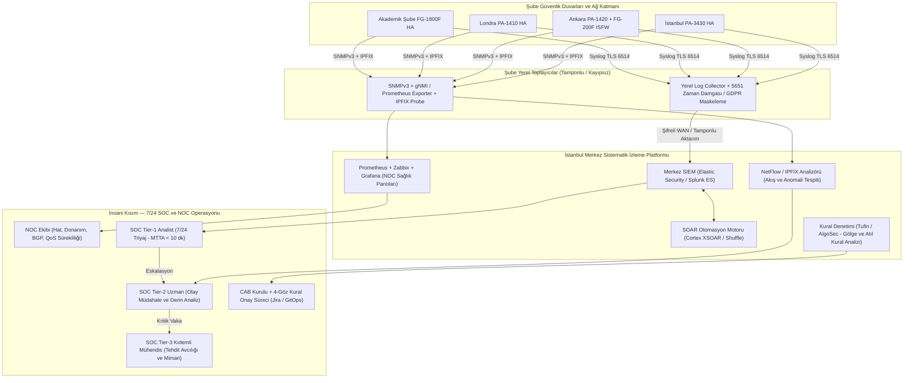

<!-- Path: dokumanlar/04-izleme-monitoring-ve-soc-mimarisi.md -->
# Profesyonel İzleme (Monitoring) Mimarisi: Sistematik Katman ve İnsani (SOC) Organizasyon

Dünyanın en güçlü güvenlik duvarını kurmak, onu **7/24 izlemedikçe** yalnızca pahalı bir kablo geçiş noktası oluşturmaktır. Profesyonel siber güvenlik ve ağ dünyasında izleme (*Monitoring & Observability*) iki ayrılmaz sütun üzerine inşa edilir:

1. **Sistematik (Teknik) Kısım:** Telemetri, log toplama, korelasyon (SIEM), akış analizi (NetFlow/NDR), performans panoları ve otomatik müdahale (SOAR).
2. **İnsani ve Süreçsel Kısım (People & Process):** SOC/NOC vardiya mimarisi, kademeli analist rolleri (L1/L2/L3), alarm yorgunluğunu (*Alert Fatigue*) önleme, değişiklik yönetimi (CAB) ve 4-Göz Prensibi.

---

## 1. Uçtan Uca İzleme Mimarisi Diyagramı

---

## 2. Sistematik Kısım: Profesyonel Dünyada Teknik Olarak Nasıl İzlenir?

Profesyonel kurumlarda güvenlik duvarları tek bir araçla değil, **4 farklı veri düzleminin** birleştirilmesiyle izlenir:

### 2.1. Güvenlik Olay ve Log İzleme (SIEM — Security Information and Event Management)
- **Ne Toplanır:** Güvenlik duvarlarından çıkan *Traffic Log*, *Threat/IPS Log*, *URL Filtering Log*, *Data Filtering (DLP)*, *Authentication (User-ID / 802.1X)* ve *Config Audit Log* kayıtları **RFC 5424 Syslog over TLS (TCP 6514)** ile şifreli olarak toplanır.
- **Kayıpsız Yerel Tamponlama (Store-and-Forward):** Ankara, Londra veya Akademik Şube'nin İstanbul ile WAN bağlantısı kesilse bile her şubedeki yerel `Log Collector` sunucusu disk üzerinde **72 saatlik logu tamponlar**; hat geldiğinde sıkıştırarak merkeze aktarır.
- **Örnek Korelasyon Kuralları:**
  - *Kural A (Yanal Hareket / Lateral Movement):* Bir istemciden (özellikle Öğrenci veya Misafir VLAN'ından) 60 saniye içinde 15'ten fazla iç IP'ye veya 10 farklı porta `DENY` kaydı oluşursa **Yüksek Öncelikli İç Tarama Alarmı** üret.
  - *Kural B (Kaba Kuvvet + Başarılı Giriş):* GlobalProtect / Kurumsal VPN kapısına 5 dakika içinde 10 başarısız kimlik doğrulamanın ardından 1 başarılı giriş gerçekleşirse (Coğrafi imkansızlık: *Impossible Travel* kontrolü dahil) kullanıcı oturumunu askıya al.
  - *Kural C (Veri Sızıntısı - AR-GE):* `RND_ISOLATED` bölgesinden dış dünyaya 1 saat içinde toplam > 500 MB giden (upload) trafik oluşursa SOC Tier-2'ye anlık bildirim düşür.

### 2.2. Performans, Kapasite ve Donanım Sağlığı İzleme (NOC — SNMPv3, gNMI, Prometheus & Grafana)
Güvenlik duvarı bir saldırı yüzünden değil, fan arızası veya oturum tablosu doluluğu yüzünden de durabilir. **Zabbix + Prometheus + Grafana** ile 30 saniyelik aralıklarla şu metrikler izlenir ve eşik aşımlarında çağrı üretilir:

| İzlenen Metrik | Uyarı Eşiği (Warning) | Kritik Eşik (Critical) | Mühendislik Anlamı |
|---|---:|---:|---|
| **Data Plane CPU Kullanımı** | > %70 (5 dk) | > %85 (2 dk) | Paket düşmesi ve gecikme başlangıcı (Özellikle SSL Inspection yükü) |
| **Management Plane CPU / RAM** | > %75 | > %90 | Log gönderimi veya commit işlemlerinde kilitlenme riski |
| **Eşzamanlı Oturum Tablosu (%)** | > %65 | > %80 | Akademik Şube NAT/Conntrack taşması veya SYN Flood saldırısı |
| **HA Senkronizasyon Durumu** | `Out-of-Sync` (1 dk) | `Split-Brain / Down` | Birincil cihaz çökerse ikincil cihaz trafiği devralamaz! |
| **ISP Hat Doluluğu & Paket Kaybı** | Doluluk > %75 / Kayıp > %0.5 | Doluluk > %90 / Kayıp > %1.5 | Bant genişliği artırımı veya SD-WAN hat değiştirme gereksinimi |
| **Donanım Sensörleri (PSU, Fan, Sıcaklık)** | > 55 °C | Tek PSU Kaybı / > 68 °C | Kabinet iklimlendirme arızası veya güç hattı kesintisi |
| **TLS Sertifika Kalan Süresi** | < 30 Gün | < 7 Gün | Süresi dolan SSL Inspection / VPN sertifikası tüm trafiği durdurur |

### 2.3. Ağ Akış ve Davranış Analizi (NetFlow v9 / IPFIX & NDR)
Loglar yalnızca oturumun başını ve sonunu söyler; **IPFIX / NetFlow** ise şubeler arası ve internet hatlarında *"Şu an bant genişliğinin %40'ını hangi IP, hangi ASN'e (Autonomous System) doğru tüketiyor?"* sorusunu saniyeler içinde yanıtlar. DDoS hacimsel saldırılarının ve şifreli tüneller içindeki anormal veri çıkışlarının tespitinde birincil araçtır.

### 2.4. Otomatik Müdahale (SOAR) ve Sürekli Kural Hijyeni (Firewall Assurance)
- **SOAR Entegrasyonu:** Doğrulanmış yüksek güvenilirlikli bir C2 (Komuta Kontrol) IP'si tespit edildiğinde SOAR platformu **External Dynamic List (EDL)** üzerinden bu IP'yi 30 saniye içinde İstanbul, Ankara, Londra ve Akademik Şube güvenlik duvarlarında eşzamanlı engeller (insan müdahalesini beklemeden dinamik liste güncellenir).
- **Kural Tabanı Denetimi (Tufin / AlgoSec / Panorama Policy Optimizer):**
  - **90 gün boyunca sıfır hit alan kurallar** (*Unused Rules*) otomatik raporlanır ve devre dışı bırakılır.
  - Üstteki geniş bir kural yüzünden asla çalışmayan **Gölge Kurallar (*Shadowed Rules*)** temizlenir.
  - Her konfigürasyon değişikliği otomatik olarak merkezi Git deposuna çekilir (*Config Drift Detection*); yetkisiz elle yapılan CLI müdahalesi anında fark edilir.

### 2.5. Yasal Uyumluluk İzlemesi (5651 ve UK-GDPR)
- **Türkiye (İstanbul, Ankara, Akademik):** 5651 sayılı kanun uyarınca yerel IP – Genel IP/Port – MAC – Kullanıcı Kimliği ve Zaman bilgileri eşleştirilerek her saat başı SHA-256 özeti alınır ve **TÜBİTAK Zaman Damgası** sunucusundan imzalanır. İmza servisi 15 dakika yanıt vermezse NOC ekranında kritik alarm oluşur.
- **Birleşik Krallık (Londra):** UK-GDPR gereği Londra çalışanlarının URL erişim loglarındaki kişisel kimlik alanları maskelenerek (*Pseudonymization*) saklanır; ham kimlik eşleştirmesi yalnızca Hukuk/DPO ve SOC Yöneticisinin çift anahtarlı onayıyla (*Dual-Custody*) açılabilir.

---

## 3. İnsani Kısım: Organizasyon, Vardiya, Süreç ve Mühendislik Kültürü

Teknoloji tek başına saldırıyı yorumlayamaz ve iş bağlamını bilemez. Profesyonel dünyada izlemenin **insani boyutu** aşağıdaki yapıyla işletilir:

### 3.1. 7/24 SOC ve NOC Katmanlı Ekip Yapısı

Merkez SOC İstanbul'da konumlanır; Ankara, Londra ve Akademik Şube'deki yerel teknik ekiplerle entegre çalışır. 7 gün 24 saat kesintisiz izleme için **3 Vardiya (08:00–16:00, 16:00–00:00, 00:00–08:00)** + rotasyonlu izin sistemi uygulanır:

| Rol / Kademe | Görev Tanımı ve Sorumluluk | Hedef Müdahale Süresi (SLA) |
|---|---|---|
| **NOC Mühendisi (Ağ Sürekliliği)** | ISP hat kesintileri, BGP komşuluk düşmeleri, QoS tıkanıklıkları, HA donanım arızaları ve servis sağlayıcı arıza kaydı eskalasyonu. | **< 5 Dakika** (İlk tespit ve ISP bildirimi) |
| **SOC Tier-1 Analist (Gözlem & Triyaj)** | SIEM panolarını canlı izler, gelen alarmları standart **Playbook** adımlarına göre doğrular, yanlış pozitifleri (*False Positive*) ayıklar ve gerçek vakaları Tier-2'ye aktarır. | **MTTA < 10 Dakika** (Alarmı üstlenme) |
| **SOC Tier-2 Uzman (Olay Müdahale)** | Paket yakalama (`pcap`), uç nokta (EDR) korelasyonu, zararlı trafik analizi yapar; acil karantina veya geçici güvenlik duvarı engelleme kurallarını uygular. | **MTTR < 45 Dakika** (İzolasyon/Çevreleme) |
| **SOC Tier-3 Kıdemli Mühendis & Tehdit Avcısı** | Alarm beklemeden ham loglarda proaktif **Tehdit Avcılığı (*Threat Hunting*)** yapar, MITRE ATT&CK kapsam boşluklarını kapatır, karmaşık NGFW/SSL Inspection mimarisini iyileştirir. | Haftalık Av Döngüsü / Kritik Vaka Liderliği |
| **SOC Yöneticisi & CISO** | Kriz yönetimi, yasal bildirimler (USOM / KVKK / UK ICO), bütçe, vardiya sağlığı ve üst yönetim raporlaması. | Kritik Seviye (Sev-1) 15 dk içinde bilgilendirme |

### 3.2. Alarm Yorgunluğunu (Alert Fatigue) Önleme Stratejisi
Gerçek dünyada SOC ekiplerinin en büyük insani zaafı **günde 10.000 anlamsız alarm düşmesi sonucu analistin gerçek saldırıyı gözden kaçırmasıdır**. Bunu önlemek için:
1. Bir analistin tek vardiyada inceleyeceği yüksek öncelikli alarm sayısı **15–25 adet** ile sınırlandırılır; gürültülü kurallar her Cuma yapılan **Haftalık Alarm İnceleme (Detection Tuning)** toplantısında iyileştirilir.
2. Tekrarlayan rutin kontroller (IP itibar sorgusu, Whois, VirusTotal/WildFire hash kontrolü, kullanıcı departman bilgisi çekme) analiste elle yaptırılmaz; SOAR tarafından alarma önceden eklenmiş (*Enriched Alert*) şekilde analistin ekranına düşer.

### 3.3. Değişiklik Yönetimi (CAB) ve 4-Göz Prensibi (Four-Eyes Principle)
Profesyonel hiçbir şirkette *"Yazılım ekibi sıkıştı, şu portu hemen açalım"* şeklinde telefon veya mesajla güvenlik duvarı kuralı yazılmaz:
1. **Talep:** İlgili ekip (ör. Ankara Yazılım veya Akademik LMS ekibi) Jira Service Management üzerinden **Kaynak IP/Bölge, Hedef IP, Port/Uygulama (App-ID), İş Gerekçesi ve Geçerlilik Süresi (TTL)** bilgilerini içeren talep açar.
2. **Güvenlik Değerlendirmesi:** Ağ güvenliği mühendisi talebin Sıfır Güven prensiplerine uygunluğunu kontrol eder (`ANY` port veya tüm alt ağ taleplerini reddeder, en dar kapsamlı hale getirir).
3. **4-Göz Prensibi:** Kuralı tasarlayıp Panorama/FortiManager'a hazırlayan mühendis ile o kuralı gözden geçirip canlıya (`Commit / Push`) basan kıdemli mühendis **farklı kişiler olmak zorundadır**.
4. **Otomatik Süre Sonu (Rule Expiration):** Test veya proje amaçlı açılan tüm geçici kurallara bitiş tarihi atanır; süre dolduğunda güvenlik duvarı kuralı otomatik devre dışı bırakır.

### 3.4. İnsani Hazırlık: Playbook'lar, Tatbikatlar ve Başarı Metrikleri (KPI)
- **Standart Playbook (Oyun Kitabı):** Gece 03:30'da çalışan bir Tier-1 analistin panik yapmaması için *"Akademik Şube DDoS Saldırısı Playbook'u"*, *"Fidye Yazılımı Şüphesi Ağ İzolasyon Playbook'u"* ve *"ISP Çift Hat Kesintisi Playbook'u"* adım adım yazılıdır.
- **Çeyreklik Masa Başı ve Mor Ekip Tatbikatları (Tabletop & Purple Team):** Her 3 ayda bir saldırı simülasyonu yapılarak hem teknik kuralların hem de insanların eskalasyon hızı ölçülür.
- **Yönetim KPI Takibi:** Aylık olarak **MTTD** (*Mean Time to Detect* — Ortalama Tespit Süresi, Hedef: < 5 dk), **MTTA** (*Mean Time to Acknowledge* — Ortalama Üstlenme Süresi, Hedef: < 10 dk), **MTTR** (*Mean Time to Respond/Contain* — Ortalama Müdahale Süresi, Hedef: < 45 dk) ve **Yanlış Pozitif Oranı** (Hedef: < %15) ölçülerek sürekli iyileştirme sağlanır.

